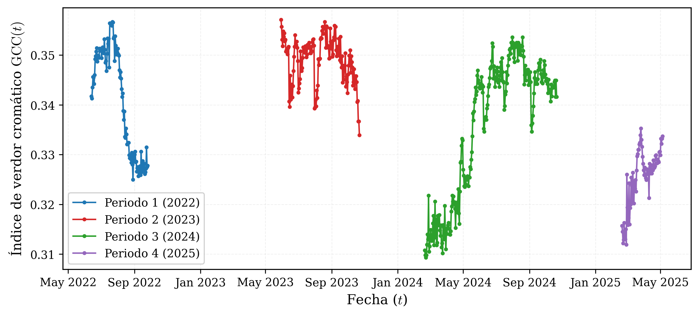
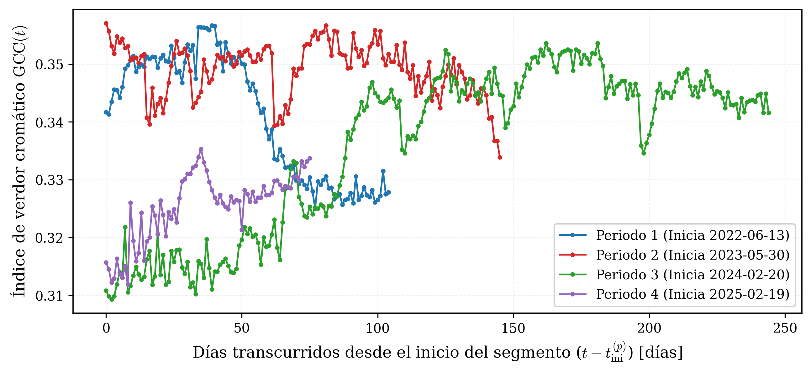
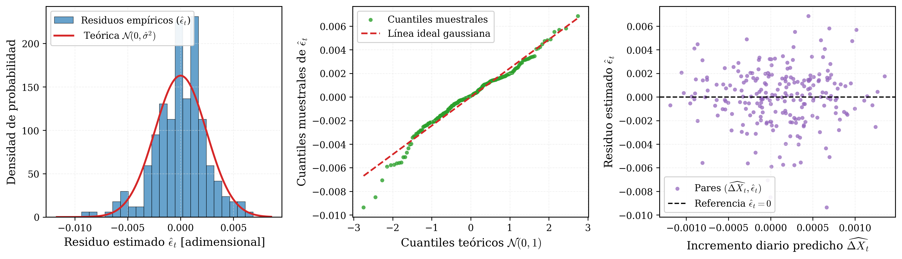

# Metodología de Estimación {#sec-metodologia-estimacion}

Para garantizar la validez empírica y la capacidad predictiva del modelo fenológico basado en la Ecuación Diferencial Estocástica con Retraso (SDDE) formulada en el Capítulo 3 (@sec-formulacion-modelo), es indispensable establecer un protocolo riguroso de procesamiento de datos, calibración paramétrica y simulación estocástica. Un modelo dinámico cuyos parámetros de deriva o intensidad de difusión se asignasen de forma arbitraria produciría trayectorias desconectadas de la fisiología real del dosel vegetal [@dietze2017ecological]. En consecuencia, el presente capítulo detalla la metodología computacional y estadística desarrollada para integrar las series observacionales de la red PhenoCam y del reanálisis climático ERA5, segmentar el dominio temporal en regímenes continuos libres de discontinuidades invernales, estimar el vector de parámetros estructurales $\boldsymbol{\theta}$ y la intensidad del ruido $\sigma$, identificar el retraso fisiológico óptimo $\tau^*$ bajo condiciones de muestra común y validar probabilísticamente el sistema mediante simulación de Monte Carlo.

::: {.callout-note}
### Nota sobre Reproducibilidad Computacional
Con el propósito de preservar una estructura editorial limpia y centrada en el desarrollo metodológico, se omite la inclusión de bloques extensos de código fuente en el texto. La totalidad de los algoritmos de limpieza, segmentación automática, regresión matricial, pruebas diagnósticas y simulación estocástica de Monte Carlo se encuentran implementados en lenguaje Python dentro del cuaderno computacional reproducible `Tesis.ipynb` del repositorio del proyecto.
:::

## Descripción de los datos y fuentes {#sec-descripcion-datos}

El conjunto de datos empleado para la calibración y validación del modelo SDDE (@eq-sdde) integra dos fuentes de información científica con resolución temporal diaria ($\Delta t=1$ día). La primera corresponde a los registros fenológicos de la estación experimental agrícola de **Röbäcksdalen**, ubicada en Umeå, provincia de Västerbotten, Suecia, en las coordenadas geográficas $63.806642^\circ\text{N}$ de latitud y $20.229243^\circ\text{E}$ de longitud. Se utiliza la serie diaria `ROI_00_GCC_MEAN` de la red PhenoCam, cuyo registro comprende el periodo del 13 de junio de 2022 al 5 de mayo de 2025 [@richardson2018tracking; @seyednasrollah2019convergence]. La segunda fuente corresponde al reanálisis climático **ERA5** del Centro Europeo de Previsiones Meteorológicas a Plazo Medio (ECMWF), del cual se obtuvieron las series históricas diarias de radiación solar (`GHI_Solar_Daily`), temperatura del aire a 2 m (`Air_Temp`) y precipitación total (`Total_Prec`), agregadas a escala regional europea NUTS-2, correspondientes al registro `S19790101_E20260131` con resolución temporal `01d` [@hersbach2020era5]. Ambas fuentes se integran temporalmente para construir la variable de estado fenológica $X(t)$ y el vector de forzantes climáticas $\mathbf{C}(t)$ definido en la @eq-vector-clima, manteniendo una frecuencia de observación compatible con el paso de discretización empleado en el esquema de Euler-Maruyama de la @sec-discretizacion-numerica.

## Preprocesamiento y manejo de datos faltantes {#sec-preprocesamiento-datos}

Antes de construir las matrices de diseño del modelo regresivo (@eq-matrices-y-x), los archivos brutos fenológicos y meteorológicos se someten a un flujo estandarizado de limpieza, depuración cronológica y control de calidad estructurado en cuatro etapas secuenciales:

1. **Estandarización cronológica y eliminación de registros duplicados:** El archivo bruto de PhenoCam (`Tesis_data.csv`) contiene inicialmente $1\,144$ filas y $21$ columnas debido a la presencia de entradas duplicadas en la marca temporal (`TIMESTAMP`). En una primera fase, el campo `TIMESTAMP` se transforma al estándar de fecha ISO-8601 (`datetime64`) y se aplica un filtro de unicidad cronológica que retiene exclusivamente la primera observación válida por día calendario (`drop_duplicates(subset=['TIMESTAMP'], keep='first')`). Este procedimiento depura exactamente la mitad redundante del archivo, consolidando una serie limpia de $M_{\text{uniq}} = 572$ días únicos observados entre el `2022-06-13` y el `2025-05-05`.

2. **Verificación de integridad intra-diaria:** Sobre las $572$ fechas únicas resultantes, se verifica la completitud matricial de los canales ópticos y de las series climáticas de ERA5 (tras omitir las $52$ líneas iniciales de encabezado técnico de metadatos en los archivos del ECMWF), confirmándose la ausencia total de valores nulos o celdas vacías ($0$ valores `NaN`) dentro de los días registrados.

3. **Preservación de las escalas físicas y precisión numérica:** A diferencia de aproximaciones heurísticas que aplican filtros de medias móviles o reescalamientos arbitrarios previos al ajuste —los cuales introducen autocorrelación artificial de medias móviles en los residuos $\epsilon_t$ y distorsionan la estructura browniana del ruido—, en este protocolo se conservan los valores diarios observados en sus unidades físicas originales del Sistema Internacional ($\text{W/m}^2$, $\text{K}$ y $\text{m}$). La disparidad de órdenes de magnitud entre columnas se resuelve numéricamente mediante aritmética de punto flotante de doble precisión (`float64`, precisión de máquina $\varepsilon_{\text{mach}} \approx 2.22 \times 10^{-16}$) y factorización matricial ortogonal-triangular ($\text{QR}$).

4. **Tratamiento riguroso de brechas estacionales sin interpolación sintética:** Si bien entre el 13 de junio de 2022 y el 5 de mayo de 2025 transcurren $1\,058$ días calendario, la serie limpia cuenta con $572$ días registrados debido a la existencia de tres interrupciones prolongadas (de $112$ a $246$ días de duración) correspondientes a los periodos invernales boreales. En lugar de aplicar interpolación lineal o por *splines* cúbicos a través de varios meses de inactividad invernal —práctica que fabricaría datos sintéticos carentes de significado fisiológico y sesgaría severamente los estimadores de deriva y difusión [@dietze2017ecological]—, las brechas temporales se aíslan de manera exacta mediante el algoritmo de segmentación en periodos continuos que se desarrolla a continuación.

## Segmentación en periodos continuos {#sec-segmentacion-periodos}

### Justificación biológica y física en latitudes boreales

La dinámica fenológica en la estación experimental de Röbäcksdalen ($63.81^\circ\text{N}$, proximidad al Círculo Polar Ártico) está gobernada por un régimen radiativo y térmico extremo [@jensen2020phenological; @buitenwerf2021phenological]. Como se fundamentó en el Capítulo 2 (@sec-fenologia-cambio-climatico), el ciclo anual en la región boreal escandinava se divide en dos regímenes biofísicamente incompatibles:

1. **Régimen de ventana vegetativa y monitoreo óptico válido (primavera tardía a otoño):** Cuando la elevación solar máxima supera el umbral mínimo de iluminación homogénea del sensor PhenoCam ($\text{MEAN\_SUN\_ELEVATION} > 15^\circ$) y la temperatura del aire permite el deshielo y la activación metabólica, el dosel vegetal experimenta los procesos continuos de brotación, expansión foliar, maduración fotosintética y senescencia gradual [@richardson2018tracking; @taiz2022plant].
2. **Régimen de dormancia invernal e interrupción radiométrica (finales de otoño a invierno):** Durante el invierno boreal, la combinación de noches polares o crepúsculos permanentes (ángulos cenitales solares cercanos o superiores a $75^\circ$), temperaturas persistentemente bajo cero y cobertura nivosa densa sobre el terreno interrumpe tanto la actividad fotosintética del cultivo como la adquisición de imágenes válidas en la red PhenoCam [@richardson2018tracking; @seyednasrollah2019convergence].

Modelar la serie multianual completa ($2022\text{--}2025$) como una única trayectoria continua ignoraría estas rupturas de régimen estacional, violando el supuesto de continuidad de las trayectorias del proceso estocástico $\{X(t)\}$ y forzando al modelo a interpretar el salto entre el otoño de un año y la primavera del año siguiente como una transición diaria [@dietze2017ecological].

### Justificación matemática y estadística en ecuaciones con retraso

Desde la perspectiva formal de la discretización de Euler-Maruyama (@sec-discretizacion-numerica) y del modelo de regresión derivado (@sec-formulacion-regresion), la continuidad estricta de paso diario ($\Delta t = 1\text{ día}$) constituye una condición necesaria para la validez de los dos operadores temporales que definen la ecuación estructural (@eq-regresion-sdde):

$$
\Delta X_t = X_{t+1} - X_t = \alpha + \beta X_t + \gamma X_{t-\tau} + \boldsymbol{\delta}^T \mathbf{C}_t + \epsilon_t.
$$ {#eq-recordatorio-regresion-cap4}

Supóngase que en el índice observacional ordenado $\{t_i\}_{i=1}^{M_{\text{uniq}}}$ existe una discontinuidad temporal entre dos registros consecutivos del archivo tal que $t_{i} - t_{i-1} = \Delta t_i > 1\text{ día}$:

* **Invalidez de la derivada discreta hacia adelante ($\Delta X_t$):** Si no se segmenta la serie en el punto de discontinuidad, el incremento calculado en el borde de la brecha sería $X(t_{i-1} + \Delta t_i) - X(t_{i-1})$, el cual acumula la deriva de $\Delta t_i$ días y posee una varianza estocástica $\sigma^2 \Delta t_i \gg \sigma^2$, destruyendo la consistencia dimensional (tasas en $\text{días}^{-1}$) y violando flagrantemente el supuesto de homocedasticidad (@eq-homocedasticidad).
* **Desfase espurio del operador de retardo ($L^\tau X_t = X_{t-\tau}$):** En cualquier dataframe indexado por posición fila, aplicar un desplazamiento de $\tau$ posiciones hacia atrás (`.shift(tau)`) a través de una brecha invernal emparejaría el estado actual de primavera $X(t_i)$ con un estado otoñal del año anterior $X(t_{i-\tau})$, separado en el tiempo real por cientos de días ($t_i - t_{i-\tau} \gg \tau$).

Por consiguiente, la partición del conjunto de datos en segmentos conexos donde $t_i - t_{i-1} \equiv 1\text{ día}$ garantiza que, dentro de cada periodo, la diferencia entre filas adyacentes corresponda exactamente a $24\text{ horas}$ y el rezago de orden $\tau$ corresponda exactamente a $\tau\text{ días}$ calendario.

### Algoritmo formal de segmentación temporal y acoplamiento climático

Sea $\mathcal{D} = \{(t_i, X_{t_i})\}_{i=1}^{M_{\text{uniq}}}$ la secuencia cronológicamente ordenada de observaciones únicas de PhenoCam ($M_{\text{uniq}} = 572$). Definimos la secuencia de diferencias temporales de primer orden como:

$$
\delta t_i = \begin{cases}
0\text{ días}, & \text{si } i = 1, \\
t_i - t_{i-1}, & \text{si } i \in \{2, 3, \dots, M_{\text{uniq}}\}.
\end{cases}
$$ {#eq-diferencia-fechas}

A partir de $\delta t_i$, se define la variable indicadora de ruptura de continuidad diaria $I_i \in \{0, 1\}$ mediante el criterio de umbral estricto de un día:

$$
I_i = \mathbb{I}\left( \delta t_i > 1\text{ día} \right) = \begin{cases}
1, & \text{si } t_i - t_{i-1} > 1\text{ día}, \\
0, & \text{si } t_i - t_{i-1} \le 1\text{ día}.
\end{cases}
$$ {#eq-indicadora-ruptura}

El identificador de periodo continuo $G_i \in \mathbb{N}$ para cada observación $i$ se obtiene como la suma acumulada de las rupturas detectadas hasta el instante $t_i$ (implementado vectorialmente en el cuaderno mediante `df['group_id'] = (df.index.to_series().diff() > pd.Timedelta(days=1)).cumsum()`):

$$
G_i = 1 + \sum_{j=1}^{i} I_j, \quad i \in \{1, 2, \dots, M_{\text{uniq}}\}.
$$ {#eq-identificador-grupo}

La función $G_i$ induce una partición exacta del índice temporal en $K = 4$ subconjuntos disjuntos y maximalmente conexos $\mathcal{P}_p = \{t_i : G_i = p\}$ para $p \in \{1, 2, 3, 4\}$. Cada subconjunto $\mathcal{P}_p$ constituye un **Periodo Continuo** caracterizado por su fecha de inicio $t_{\text{ini}}^{(p)} = \min(\mathcal{P}_p)$, su fecha de término $t_{\text{fin}}^{(p)} = \max(\mathcal{P}_p)$ y su duración ininterrumpida en días $N_p = |\mathcal{P}_p| = (t_{\text{fin}}^{(p)} - t_{\text{ini}}^{(p)}) / (1\text{ día}) + 1$.

Una vez aislados los cuatro segmentos fenológicos, se ejecuta el acoplamiento exacto por clave primaria de fecha (`Date`) con los cubos de datos meteorológicos de ERA5 (`df_SO`, `df_TA`, `df_TP`), asignando a cada día $t \in [t_{\text{ini}}^{(p)}, t_{\text{fin}}^{(p)}]$ su respectivo vector climático $\mathbf{C}_t = [\text{Rad}_t, \text{Temp}_t, \text{Prec}_t]^T$. El procedimiento completo se formaliza en el siguiente algoritmo:

::: {.callout-tip icon="false"}
### Algoritmo 4.1: Segmentación Automática en Periodos Continuos y Acoplamiento ERA5
* **Entrada:** Serie fenológica bruta $\mathcal{D}_{\text{raw}}$, series diarias ERA5 de radiación ($\mathcal{S}_{\text{Rad}}$), temperatura ($\mathcal{S}_{\text{Temp}}$) y precipitación ($\mathcal{S}_{\text{Prec}}$).
* **Salida:** Lista de $K = 4$ dataframes continuos acoplados $\{\text{DF}_1, \text{DF}_2, \text{DF}_3, \text{DF}_4\}$.

1. Convertir la columna `TIMESTAMP` de $\mathcal{D}_{\text{raw}}$ al tipo `datetime` y eliminar duplicados conservando el primer registro válido por fecha.
2. Ordenar cronológicamente las $M_{\text{uniq}} = 572$ observaciones resultantes: $t_1 < t_2 < \dots < t_{M_{\text{uniq}}}$.
3. Calcular el vector de diferencias temporales $\delta t_i = t_i - t_{i-1}$ para $i = 2, \dots, M_{\text{uniq}}$.
4. Evaluar la condición booleana de salto $I_i = \mathbb{I}(\delta t_i > 1\text{ día})$ y calcular el índice de grupo acumulado $G_i = 1 + \sum_{j=1}^i I_j$.
5. Agrupar el dataset por la clave $G_i$ generando las $K = 4$ subseries continuas $\{\mathcal{P}_1, \mathcal{P}_2, \mathcal{P}_3, \mathcal{P}_4\}$.
6. **Para cada** periodo $p = 1, 2, 3, 4$ **hacer:**
   a. Determinar los límites del intervalo continuo: $t_{\text{ini}}^{(p)} \gets \min(\mathcal{P}_p)$ y $t_{\text{fin}}^{(p)} \gets \max(\mathcal{P}_p)$.
   b. Extraer por indexación cronológica exacta las rodajas climáticas en $[t_{\text{ini}}^{(p)}, t_{\text{fin}}^{(p)}]$:
      $$\text{Rad}^{(p)} \gets \mathcal{S}_{\text{Rad}}[t_{\text{ini}}^{(p)} : t_{\text{fin}}^{(p)}], \quad \text{Temp}^{(p)} \gets \mathcal{S}_{\text{Temp}}[t_{\text{ini}}^{(p)} : t_{\text{fin}}^{(p)}], \quad \text{Prec}^{(p)} \gets \mathcal{S}_{\text{Prec}}[t_{\text{ini}}^{(p)} : t_{\text{fin}}^{(p)}].$$
   c. Ensamblar la estructura matricial completa 
      $$\text{DF}_p = [X_t, \text{Rad}_t, \text{Temp}_t, \text{Prec}_t]_{t \in \mathcal{P}_p}.$$
7. **Retornar** $\{\text{DF}_1, \text{DF}_2, \text{DF}_3, \text{DF}_4\}$.
:::

### Caracterización de los periodos continuos resultantes

La aplicación del Algoritmo 4.1 sobre los registros de Röbäcksdalen estructura los $572$ días válidos en los cuatro periodos continuos resumidos en la @tbl-resumen-segmentacion.

| Periodo | Fecha de Inicio ($t_{\text{ini}}^{(p)}$) | Fecha de Fin ($t_{\text{fin}}^{(p)}$) | Duración ($N_p$, días) | $\text{GCC}$ Medio | $\text{GCC}$ Mínimo | $\text{GCC}$ Máximo | Régimen Fenológico Predominante |
| :---: | :---: | :---: | :---: | :---: | :---: | :---: | :--- |
| **Periodo 1** | 2022-06-13 | 2022-09-25 | $105$ | $0.340976$ | $0.3250$ | $0.3567$ | Pico estival y senescencia otoñal |
| **Periodo 2** | 2023-05-30 | 2023-10-22 | $146$ | $0.349105$ | $0.3339$ | $0.3571$ | Maduración de verano y declive otoñal |
| **Periodo 3** | 2024-02-20 | 2024-10-21 | $245$ | $0.335706$ | $0.3093$ | $0.3536$ | Ciclo completo (fin de invierno a otoño) |
| **Periodo 4** | 2025-02-19 | 2025-05-05 | $76$ | $0.325455$ | $0.3119$ | $0.3353$ | Salida de dormancia y reverdecimiento |
| **Total / Global** | **2022-06-13** | **2025-05-05** | **572** | **0.338732** | **0.3093** | **0.3571** | **4 campañas interanuales** |

: Resumen de la segmentación automática en periodos continuos de monitoreo fenológico en Umeå, Suecia. {#tbl-resumen-segmentacion}

Como revela la @tbl-resumen-segmentacion, la segmentación captura una notable diversidad de fases fenológicas que enriquecen la estimación del modelo SDDE:

* Los **Periodos 1 y 2** ($105$ y $146\text{ días}$, respectivamente) inician a finales de mayo o mediados de junio, cuando el dosel ya ha alcanzado altos niveles de verdor ($\text{GCC} > 0.34$), abarcando la meseta de máxima actividad fotosintética estival y la transición hacia la senescencia de septiembre y octubre.

* El **Periodo 3** constituye la serie continua más extensa del estudio ($N_3 = 245\text{ días}$, desde febrero hasta octubre de 2024), capturando de manera ininterrumpida la línea base pre-vegetativa ($\text{GCC}_{\min} = 0.3093$), la fase completa de reverdecimiento primaveral (*green-up*), el máximo estival ($\text{GCC}_{\max} = 0.3536$) y el inicio del declive otoñal. Por su completitud y tamaño muestral, el Periodo 3 funge como el segmento de referencia principal para las pruebas de diagnóstico, validación temporal y sensibilidad.

* El **Periodo 4** ($N_4 = 76\text{ días}$, de febrero a mayo de 2025) documenta específicamente la dinámica de activación térmica y lumínica de finales de invierno y primavera temprana.

La @fig-serie-segmentada muestra la distribución cronológica de los cuatro segmentos continuos separados por las brechas invernales boreales, mientras que la @fig-periodos-normalizados contrasta sus trayectorias alineadas respecto al día relativo de inicio ($t_{\text{rel}} = 0, 1, \dots, N_p - 1$) de cada periodo.

::: {#fig-serie-segmentada}

{width=100% fig-align="center"}

Serie temporal histórica del índice de verdor cromático ($\text{GCC}$) en Röbäcksdalen (Umeå, Suecia), ilustrando la partición automática en cuatro periodos continuos de muestreo diario separados por las interrupciones invernales.
:::

::: {#fig-periodos-normalizados}
<!-- ESPACIO PARA INSERTAR LA FIGURA 4.2 EXTRAÍDA DEL NOTEBOOK -->
<!-- Descomentar la siguiente línea al colocar el archivo de imagen en tu carpeta: -->
{width=100% fig-align="center"}

Comparación superpuesta de la dinámica del índice $\text{GCC}$ en los cuatro periodos continuos en función de los días transcurridos desde el inicio de cada segmento ($t - t_{\text{ini}}^{(p)}$).
:::

## Estimación de parámetros por mínimos cuadrados ordinarios (OLS) {#sec-metodologia-ols}

### Construcción de las matrices de diseño por periodo

Para cada periodo continuo $p \in \{1, 2, 3, 4\}$ de longitud $N_p$ días y dado un retraso fisiológico candidato $\tau \in \mathbb{N}$ (con $\Delta t = 1\text{ día}$), la función modular `construir_dataset_sdde(df_periodo, tau, tau_min_corte)` del cuaderno computacional transforma el dataframe acoplado $\text{DF}_p$ en las estructuras matriciales requeridas por la formulación regresiva (@eq-modelo-matricial).

Específicamente, para cada día $t \in \{\tau_{\text{corte}}, \tau_{\text{corte}} + 1, \dots, N_p - 2\}$, donde $\tau_{\text{corte}} = \tau$ cuando se emplea la muestra completa del periodo o $\tau_{\text{corte}} = \tau_{\max}$ cuando se impone un punto de corte común entre distintos retardos, se construyen:
1. El vector de incrementos observados hacia adelante $\mathbf{Y}^{(p)} \in \mathbb{R}^{n_p \times 1}$, cuyas entradas son $y_t^{(p)} = \Delta X_t^{(p)} = X_{t+1}^{(p)} - X_t^{(p)}$ (calculado mediante `df_f["X_t"].shift(-1) - df_f["X_t"]`).
2. La matriz de diseño $\mathbf{X}^{(p)}(\tau) \in \mathbb{R}^{n_p \times 6}$, cuya fila asociada al día $t$ es el vector $\mathbf{x}_t^{(p)T}(\tau) = \left[1, \, X_t^{(p)}, \, X_{t-\tau}^{(p)}, \, \text{Rad}_t^{(p)}, \, \text{Temp}_t^{(p)}, \, \text{Prec}_t^{(p)}\right]$, donde el estado retardado se genera aplicando el operador `df_f["ROI_00_GCC_MEAN"].shift(tau)`.

Al descartar los primeros $\tau_{\text{corte}}$ registros (que carecen de estado retardado observado dentro del mismo segmento continuo) y el último registro $t = N_p - 1$ (que carece de incremento futuro $\Delta X_{N_p-1}$), se obtiene una matriz libre de valores faltantes con exactamente $n_p = N_p - \tau_{\text{corte}} - 1$ filas efectivas. Así, para el retraso base de referencia $\tau = 15\text{ días}$, los tamaños muestrales efectivos de estimación son $n_1 = 89$, $n_2 = 130$, $n_3 = 229$ y $n_4 = 60$ transiciones diarias.

### Implementación computacional del estimador OLS

Una vez ensamblados $\mathbf{Y}^{(p)}$ y $\mathbf{X}^{(p)}$ para cada periodo $p$, el vector de parámetros específicos del periodo $\hat{\boldsymbol{\theta}}^{(p)} = \left[\hat{\alpha}^{(p)}, \hat{\beta}^{(p)}, \hat{\gamma}^{(p)}, \hat{\delta}_1^{(p)}, \hat{\delta}_2^{(p)}, \hat{\delta}_3^{(p)}\right]^T \in \mathbb{R}^6$ se calcula resolviendo el sistema de ecuaciones normales deducido en la @sec-identificabilidad-estimacion:

$$
\left( \mathbf{X}^{(p)T} \mathbf{X}^{(p)} \right) \hat{\boldsymbol{\theta}}^{(p)} = \mathbf{X}^{(p)T} \mathbf{Y}^{(p)}.
$$ {#eq-sistema-normal-periodo}

En el cuaderno computacional (Sección 4.4), la resolución numérica de la @eq-sistema-normal-periodo se ejecuta mediante un esquema de verificación cruzada:
* Por un lado, se resuelve directamente el sistema lineal simétrico mediante el solucionador algebraico `np.linalg.solve(X_periodo.T @ X_periodo, X_periodo.T @ Y_periodo)`.
* Simultáneamente, la función `ajustar_ols_sdde(df_m)` ajusta el objeto estadístico `sm.OLS(Y, X).fit()` de la librería `statsmodels`, el cual emplea factorización $\text{QR}$/$\text{SVD}$ para extraer además del vector $\hat{\boldsymbol{\theta}}^{(p)}$, los errores estándar $\text{SE}(\hat{\theta}_j^{(p)})$, los estadísticos $t_j^{(p)}$, los $p$-valores bilaterales, los residuos $\hat{\boldsymbol{\epsilon}}^{(p)} = \mathbf{Y}^{(p)} - \mathbf{X}^{(p)}\hat{\boldsymbol{\theta}}^{(p)}$ y las métricas de información ($\text{AIC}$, $\text{BIC}$, $R^2$ y $R^2_{\text{adj}}$).

::: {.callout-tip icon="false"}
### Algoritmo 4.2: Estimación OLS Modular por Periodo Continuo
* **Entrada:** Lista de dataframes continuos $\{\text{DF}_1, \dots, \text{DF}_K\}$, retraso temporal $\tau \in \mathbb{N}$, corte opcional $\tau_{\text{corte}}$.
* **Salida:** Vectores estimados $\{\hat{\boldsymbol{\theta}}^{(p)}\}_{p=1}^K$, matrices de covarianza y vectores de residuos $\{\hat{\boldsymbol{\epsilon}}^{(p)}\}_{p=1}^K$.

1. **Para cada** periodo $p = 1, \dots, K$ **hacer:**
   a. Definir el índice de recorte inicial: $c_0 \gets \max(\tau, \tau_{\text{corte}})$ si $\tau_{\text{corte}}$ está definido; en caso contrario, $c_0 \gets \tau$.
   b. Construir la columna retardada $X_{t-\tau}^{(p)}$ desplazando $X_t^{(p)}$ en $\tau$ posiciones hacia adelante en el índice.
   c. Construir la variable respuesta $\Delta X_t^{(p)} = X_{t+1}^{(p)} - X_t^{(p)}$.
   d. Recortar el dataframe al rango de filas válidas $[c_0, N_p - 2]$, obteniendo $n_p = N_p - c_0 - 1$ observaciones completas.
   e. Formar el vector respuesta $\mathbf{Y}^{(p)} \in \mathbb{R}^{n_p \times 1}$ y la matriz de diseño con intercepto $\mathbf{X}^{(p)} \in \mathbb{R}^{n_p \times 6}$.
   f. Resolver el sistema normal $\left(\mathbf{X}^{(p)T}\mathbf{X}^{(p)}\right)\hat{\boldsymbol{\theta}}^{(p)} = \mathbf{X}^{(p)T}\mathbf{Y}^{(p)}$.
   g. Calcular el vector de residuos $\hat{\boldsymbol{\epsilon}}^{(p)} \gets \mathbf{Y}^{(p)} - \mathbf{X}^{(p)}\hat{\boldsymbol{\theta}}^{(p)}$ y los errores estándar $\text{SE}(\hat{\boldsymbol{\theta}}^{(p)})$ mediante la @eq-error-estandar.
2. **Retornar** $\{\hat{\boldsymbol{\theta}}^{(p)}, \text{SE}(\hat{\boldsymbol{\theta}}^{(p)}), \hat{\boldsymbol{\epsilon}}^{(p)}\}_{p=1}^K$.
:::

### Estimación individual por periodo frente a estimación agrupada (*Pooled OLS*)

La disponibilidad de $K = 4$ periodos continuos permite implementar dos estrategias complementarias de estimación paramétrica dependiendo del objetivo inferencial:

1. **Estimación específica por periodo ($\hat{\boldsymbol{\theta}}^{(p)}$):** Ajusta el modelo de forma independiente sobre cada segmento $\mathcal{P}_p$. Esta estrategia permite capturar la heterogeneidad interanual y estacional de los parámetros biofísicos (por ejemplo, contrastar la intensidad de la autorregulación $\beta$ o de la memoria $\gamma$ entre un periodo primaveral como $P_4$ y un ciclo completo como $P_3$).
2. **Estimación agrupada o concatenada (*Pooled OLS*, $\hat{\boldsymbol{\theta}}_{\text{pool}}$):** Cuando se requiere estimar un vector de parámetros global para evaluar la capacidad de generalización fuera de muestra —como en el protocolo de validación *Leave-One-Dataset-Out* (LODO) implementado en la Sección 5.5.2 del cuaderno—, se concatenan verticalmente las matrices de diseño y vectores de respuesta de un subconjunto de periodos de entrenamiento $\mathcal{J} \subset \{1, 2, 3, 4\}$.

Un aspecto metodológico fundamental de nuestra implementación del estimador *pooled* es que **los operadores de diferencia $\Delta X_t$ y de retardo $X_{t-\tau}$ se calculan primero de manera estrictamente interna dentro de cada periodo individual $j \in \mathcal{J}$** (usando `construir_dataset_sdde` por separado), y únicamente después de haber recortado las primeras $\tau$ filas de cada segmento se procede al apilamiento matricial (`pd.concat(dfs_train_k, axis=0, ignore_index=True)`):

$$
\mathbf{Y}_{\mathcal{J}} = \begin{bmatrix} \mathbf{Y}^{(j_1)} \\ \vdots \\ \mathbf{Y}^{(j_m)} \end{bmatrix} \in \mathbb{R}^{\left(\sum_{j \in \mathcal{J}} n_j\right) \times 1}, \qquad
\mathbf{X}_{\mathcal{J}} = \begin{bmatrix} \mathbf{X}^{(j_1)} \\ \vdots \\ \mathbf{X}^{(j_m)} \end{bmatrix} \in \mathbb{R}^{\left(\sum_{j \in \mathcal{J}} n_j\right) \times 6}.
$$ {#eq-matrices-pooled}

El estimador agrupado sobre la colección de periodos $\mathcal{J}$ viene dado entonces por:

$$
\hat{\boldsymbol{\theta}}_{\text{pool}}(\mathcal{J}) = \left( \mathbf{X}_{\mathcal{J}}^T \mathbf{X}_{\mathcal{J}} \right)^{-1} \mathbf{X}_{\mathcal{J}}^T \mathbf{Y}_{\mathcal{J}} = \left( \sum_{j \in \mathcal{J}} \mathbf{X}^{(j)T} \mathbf{X}^{(j)} \right)^{-1} \left( \sum_{j \in \mathcal{J}} \mathbf{X}^{(j)T} \mathbf{Y}^{(j)} \right).
$$ {#eq-estimador-pooled}

Este diseño en dos etapas garantiza matemáticamente que ninguna fila de $\mathbf{X}_{\mathcal{J}}$ mezcle jamás observaciones pertenecientes a años distintos.

## Estimación de la intensidad del ruido estocástico {#sec-estimacion-ruido}

### Estimadores de la volatilidad en el esquema discretizado: $\hat{\sigma}_{\text{OLS}}$ versus $\hat{\sigma}_{\text{MLE}}$

En la representación discretizada de Euler-Maruyama con paso diario $\Delta t = 1\text{ día}$, las perturbaciones aleatorias $\epsilon_t = \Delta X_t - \mathbf{x}_t^T \boldsymbol{\theta}$ absorben el efecto acumulado de la volatilidad ambiental durante un día. A partir de la secuencia de residuos estimados $\hat{\epsilon}_t = \Delta X_t - \mathbf{x}_t^T \hat{\boldsymbol{\theta}}_{\text{OLS}}$ para $t \in \{1, \dots, n\}$ (donde $n = n_p$ denota el tamaño muestral efectivo del periodo y $k = 6$ es el rango de la matriz de diseño $\mathbf{X}$), se implementan en el cuaderno computacional dos estimadores para cuantificar la desviación estándar del ruido diario $\sigma$:

1. **Estimador insesgado de varianza corregido por grados de libertad ($\hat{\sigma}_{\text{OLS}}$):** Como se demostró en la @sec-identificabilidad-estimacion, dado que el vector de residuos $\hat{\boldsymbol{\epsilon}} = (\mathbf{I}_n - \mathbf{H})\boldsymbol{\epsilon}$ habita en un subespacio lineal de dimensión $n - k = n - 6$, la suma de cuadrados de los residuos $\text{RSS} = \sum_{t=1}^n \hat{\epsilon}_t^2$ tiene esperanza matemática $\mathbb{E}[\text{RSS}] = (n - k)\sigma^2$. Dividiendo entre los $n - k$ grados de libertad residuales se obtiene el estimador (`sigma_ols = np.sqrt(np.sum(residuos**2) / (n_obs - k_params))`):

$$
\hat{\sigma}_{\text{OLS}} = \sqrt{ \frac{1}{n - k} \sum_{t=1}^{n} \hat{\epsilon}_t^2 }, \quad \text{con } k = 6.
$$ {#eq-cap4-sigma-ols}

2. **Estimador de Máxima Verosimilitud Condicional ($\hat{\sigma}_{\text{MLE}}$):** Al maximizar directamente la función de log-verosimilitud gaussiana condicional (@eq-log-verosimilitud) respecto a $\sigma^2$, el divisor que anula la derivada parcial es el tamaño muestral completo $n$. Dado que la media aritmética de los residuos de una regresión con intercepto es exactamente cero ($\bar{\hat{\epsilon}} = \frac{1}{n}\sum_{t=1}^n \hat{\epsilon}_t = 0$), este estimador coincide con la desviación estándar muestral no corregida de los residuos (`sigma_mle = np.std(residuos)`):

$$
\hat{\sigma}_{\text{MLE}} = \sqrt{ \frac{1}{n} \sum_{t=1}^{n} \hat{\epsilon}_t^2 }.
$$ {#eq-cap4-sigma-mle}

#### Relación algebraica, factor de corrección en muestras finitas e intervalos de confianza

Comparando las Ecuaciones (@eq-cap4-sigma-ols) y (@eq-cap4-sigma-mle), ambos estimadores están vinculados de manera exacta por el factor determinista de grados de libertad:

$$
\hat{\sigma}_{\text{MLE}} = \sqrt{\frac{n - k}{n}} \, \hat{\sigma}_{\text{OLS}} = \sqrt{1 - \frac{6}{n}} \, \hat{\sigma}_{\text{OLS}}.
$$ {#eq-factor-correccion-sigma}

Mediante una expansión de Taylor de primer orden, se observa que $\hat{\sigma}_{\text{MLE}} \approx \left(1 - \frac{3}{n}\right)\hat{\sigma}_{\text{OLS}}$, por lo que la discrepancia relativa entre ambos estimadores es de orden $\mathcal{O}(n^{-1})$:

* En periodos extensos como el **Periodo 3** ($n_3 = 229$ para $\tau = 15$), el factor de escala es $\sqrt{223/229} = 0.9868$, produciendo valores prácticamente idénticos ($\hat{\sigma}_{\text{OLS}} = 0.002481$ frente a $\hat{\sigma}_{\text{MLE}} = 0.002448$, una diferencia de apenas $3.3 \times 10^{-5}$ unidades de $\text{GCC}$).

* En segmentos más cortos como el **Periodo 4** ($n_4 = 60$), el factor es $\sqrt{54/60} = 0.9487$ ($\hat{\sigma}_{\text{OLS}} = 0.002095$ frente a $\hat{\sigma}_{\text{MLE}} = 0.001988$), donde la corrección por grados de libertad de $\hat{\sigma}_{\text{OLS}}$ evita subestimar la incertidumbre en un $5.1\%$.

### Recuperación del coeficiente de difusión continuo $\sigma_{\text{SDDE}}$: Método de Momentos versus Verosimilitud Heterocedástica

Como se estableció en la formulación continua de la @eq-sdde inspirada en @rupsys2008stochastic, cuando el término de difusión se especifica de forma multiplicativa proporcional al estado biológico, $g(X(t)) = \sigma_{\text{SDDE}} X(t) \, dW(t)$, el error de discretización de Euler-Maruyama tiene la estructura:

$$
\epsilon_t = \sigma_{\text{SDDE}} X_t \, \Delta W_t, \quad \text{con } \Delta W_t \sim \mathcal{N}(0, \Delta t).
$$ {#eq-error-multiplicativo}

Por consiguiente, la varianza condicional teórica del incremento diario dado el estado actual $X_t$ es proporcional al cuadrado del nivel de verdor:

$$
\text{Var}(\epsilon_t \mid \mathcal{F}_t) = \sigma_{\text{SDDE}}^2 X_t^2 \Delta t.
$$ {#eq-varianza-condicional-sdde}

Para recuperar el parámetro de volatilidad relativa continua $\sigma_{\text{SDDE}}$ (en unidades $\text{días}^{-1/2}$) a partir de las observaciones discretas, se plantean dos enfoques analíticos complementarios:

#### Enfoque de igualación de momentos bajo cuasi-homocedasticidad

Siguiendo el argumento de linealización local de @shoji1998estimation y @rupsys2008stochastic, cuando el proceso positivo $X_t$ evoluciona en un rango estrecho alrededor de su media $\bar{X}$ (recordando que en Röbäcksdalen $X_t \in [0.3093, 0.3571]$, por lo que el factor $X_t^2$ varía mínimamente alrededor de $\overline{X^2} \approx 0.115$), la varianza incondicional media de los errores satisface $\mathbb{E}[\text{Var}(\epsilon_t \mid \mathcal{F}_t)] = \sigma_{\text{SDDE}}^2 \mathbb{E}[X_t^2]\Delta t \approx \sigma^2$. Igualando la varianza residual estimada por OLS ($\hat{\sigma}_{\text{OLS}}^2$) con el segundo momento muestral del estado, se deduce el estimador por el método de los momentos:

$$
\hat{\sigma}_{\text{SDDE}}^{\text{(MM)}} = \sqrt{ \frac{\hat{\sigma}_{\text{OLS}}^2}{\frac{1}{n} \sum_{t=1}^{n} X_t^2 \Delta t} } = \frac{\hat{\sigma}_{\text{OLS}}}{\sqrt{\Delta t \, \overline{X^2}}}.
$$ {#eq-sigma-sdde-momentos}

#### Enfoque de Máxima Verosimilitud bajo estructura heterocedástica

Como alternativa directa que aprovecha explícitamente la dependencia proporcional al estado en la @eq-varianza-condicional-sdde, condicional a $\mathcal{F}_t$ cada innovación sigue la distribución gaussiana heterocedástica $\epsilon_t \mid \mathcal{F}_t \sim \mathcal{N}(0, \sigma_{\text{SDDE}}^2 X_t^2 \Delta t)$. La función de log-verosimilitud condicional para $(\boldsymbol{\theta}, \sigma_{\text{SDDE}})$ toma entonces la forma:

$$
\ell_{\text{het}}(\boldsymbol{\theta}, \sigma_{\text{SDDE}}) = -\frac{n}{2}\ln(2\pi) - \frac{1}{2}\sum_{t=1}^{n} \ln\left(\sigma_{\text{SDDE}}^2 X_t^2 \Delta t\right) - \frac{1}{2\sigma_{\text{SDDE}}^2 \Delta t} \sum_{t=1}^{n} \frac{\left(\Delta X_t - \mathbf{x}_t^T \boldsymbol{\theta}\right)^2}{X_t^2}.
$$ {#eq-loglik-heterocedastica}

Derivando la @eq-loglik-heterocedastica respecto a $\sigma_{\text{SDDE}}^2$, igualando a cero y evaluando en los residuos estimados $\hat{\epsilon}_t = \Delta X_t - \mathbf{x}_t^T \hat{\boldsymbol{\theta}}_{\text{OLS}}$:

$$
\frac{\partial \ell_{\text{het}}}{\partial (\sigma_{\text{SDDE}}^2)} = -\frac{n}{2\sigma_{\text{SDDE}}^2} + \frac{1}{2\left(\sigma_{\text{SDDE}}^2\right)^2 \Delta t} \sum_{t=1}^{n} \frac{\hat{\epsilon}_t^2}{X_t^2} = 0,
$$ {#eq-derivada-loglik-het}

se obtiene el estimador de máxima verosimilitud ponderado por el estado:

$$
\hat{\sigma}_{\text{SDDE}}^{\text{(MLE)}} = \sqrt{ \frac{1}{n \Delta t} \sum_{t=1}^{n} \left( \frac{\hat{\epsilon}_t}{X_t} \right)^2 }.
$$ {#eq-sigma-sdde-mle}

La @eq-sigma-sdde-mle tiene una interpretación biofísica transparente: mide la raíz del error cuadrático medio de los residuos expresados como proporción relativa del verdor actual ($\hat{\epsilon}_t / X_t$). Cuando la variabilidad relativa del estado es baja ($X_t \approx \bar{X}$), ambos estimadores (@eq-sigma-sdde-momentos y @eq-sigma-sdde-mle) convergen al mismo valor numérico ($\hat{\sigma}_{\text{SDDE}} \approx \hat{\sigma} / \bar{X} \approx 0.00245 / 0.336 \approx 0.0073\text{ días}^{-1/2}$).

### Verificación empírica de los supuestos sobre el ruido estocástico

En la Sección 4.5 del cuaderno computacional (`Tesis.ipynb`), la validez de los supuestos sobre la innovación $\epsilon_t$ se audita sistemáticamente en los cuatro periodos aplicando la batería de pruebas estadísticas formales definidas en la @sec-diagnostico-validacion: Shapiro-Wilk ($W$) y Jarque-Bera ($JB$) para la normalidad, Breusch-Pagan ($LM_{\text{BP}}$) para la homocedasticidad, y Durbin-Watson ($DW$) junto con Ljung-Box hasta el rezago $10$ ($Q_{\text{LB}}(10)$) para la independencia serial.

Asimismo, como se ilustra en la @fig-diagnostico-residuos para el Periodo 3 (el segmento continuo de mayor longitud, con $n_3 = 229$ observaciones efectivas para $\tau = 15$), se genera una inspección gráfica tripartita de los residuos $\hat{\epsilon}_t$: (a) superposición del histograma de densidad empírica contra la campana gaussiana teórica $\mathcal{N}(0, \hat{\sigma}_{\text{MLE}}^2)$, (b) gráfico cuantil-cuantil (*Q-Q Plot*) normal para identificar desviaciones en las colas atribuibles a eventos meteorológicos abruptos, y (c) diagrama de dispersión de los residuos frente a los incrementos predichos $\Delta \hat{X}_t$ para corroborar la ausencia de patrones de heterocedasticidad en forma de cono.

::: {#fig-diagnostico-residuos}
<!-- ESPACIO PARA INSERTAR LA FIGURA 4.3 EXTRAÍDA DEL NOTEBOOK -->
<!-- Descomentar la siguiente línea al colocar el archivo de imagen en tu carpeta: -->
{width=100% fig-align="center"}

Panel de diagnóstico visual de los residuos estimados $\hat{\epsilon}_t$ en el Periodo 3 ($n = 229$, $\tau = 15\text{ días}$): (a) Histograma empírico y curva de densidad normal teórica $\mathcal{N}(0, \hat{\sigma}^2)$; (b) Gráfico Q-Q normal de cuantiles muestrales frente a cuantiles teóricos; (c) Dispersión de residuos frente a valores ajustados ($\Delta \hat{X}_t$) confirmando homocedasticidad.
:::

## Selección óptima del retraso temporal ($\tau$) {#sec-seleccion-tau}

### Planteamiento del problema y espacio de búsqueda biológicamente admisible

Como se demostró en el análisis de identificabilidad estructural (@sec-identificabilidad-estimacion), el retraso temporal $\tau$ ingresa de manera no lineal en el modelo regresivo (@eq-regresion-sdde) a través del operador de desplazamiento de índice $X_{t-\tau}$, lo que impide obtenerlo mediante diferenciación algebraica directa de la suma de cuadrados. En consecuencia, la identificación del retraso óptimo $\tau^*$ se formula como un problema de **optimización discreta por perfilación de verosimilitud** (*grid search profile likelihood*) sobre una malla finita de retardos candidatos:

$$
\mathcal{T} = \left\{ \tau_{\min}, \, \tau_{\min} + 1, \, \dots, \, \tau_{\max} \right\} = \left\{ 3, 4, 5, \dots, 23 \right\}\text{ días}.
$$ {#eq-malla-busqueda-tau}

La delimitación del espacio de búsqueda en $\mathcal{T} = \{3, \dots, 23\}\text{ días}$ responde a dos criterios metodológicos y ecofisiológicos:

1. **Cota inferior ($\tau_{\min} = 3\text{ días}$):** Se excluyen los rezagos inmediatos $\tau \in \{1, 2\}\text{ días}$ tanto para evitar la colinealidad extrema con el estado presente $X_t$ (que degradaría el número de condición de la matriz $\mathbf{X}^T\mathbf{X}$), como porque las fluctuaciones de $24\text{ a }48\text{ horas}$ reflejan persistencia radiométrica y respuestas estomáticas rápidas más que procesos de translocación estructural [@ogle2015quantifying].

2. **Cota superior ($\tau_{\max} = 23\text{ días}$):** Abarca más de tres semanas completas, cubriendo el horizonte fisiológico requerido para la movilización vascular de carbohidratos no estructurales por el floema, la división celular meristemática y la biosíntesis de clorofila en nuevas láminas foliares [@taiz2022plant; @thomas2014stay], sin agotar excesivamente los grados de libertad en el periodo más corto ($P_4$, de $76\text{ días}$).

### Estandarización por muestra común para la comparabilidad estricta de criterios de información

Un error metodológico frecuente en la literatura aplicada al comparar modelos autorregresivos o de ecuaciones con retraso para distintos valores de $\tau \in \mathcal{T}$ consiste en evaluar el Criterio de Información de Akaike ($\text{AIC}$) o el Criterio Bayesiano de Schwarz ($\text{BIC}$) utilizando todos los datos disponibles para cada $\tau$ individual, es decir, sobre un tamaño muestral variable $n_{\text{libre}}(\tau) = N_p - \tau - 1$.

Para comprender por qué dicho proceder invalida la comparación, basta observar la expresión analítica del $\text{AIC}$ en un modelo gaussiano de $k = 6$ parámetros ajustado sobre $n(\tau)$ observaciones:

$$
\text{AIC}_{\text{libre}}(\tau) = n(\tau)\left[ \ln(2\pi) + 1 + \ln\left(\hat{\sigma}_{\text{MLE}}^2(\tau)\right) \right] + 2k.
$$ {#eq-sesgo-aic-libre}

Dado que en nuestros datos fenológicos la varianza residual es del orden de $\hat{\sigma}_{\text{MLE}}^2 \approx 6 \times 10^{-6}$, el término entre corchetes es fuertemente negativo ($\ln(2\pi) + 1 + \ln(6 \times 10^{-6}) \approx -9.18$). Por tanto, en la @eq-sesgo-aic-libre, $\text{AIC}_{\text{libre}}(\tau)$ es directamente proporcional al número de observaciones $n(\tau) = N_p - \tau - 1$: cada vez que $\tau$ disminuye en $1\text{ día}$, el modelo gana una observación adicional y su $\text{AIC}_{\text{libre}}$ disminuye artificialmente en $\approx 9.18$ unidades, independientemente de si ese retraso $\tau$ explica mejor o peor la dinámica biológica. Esto induciría un sesgo trivial que elegiría siempre el menor retraso posible ($\tau = \tau_{\min}$).

Para eliminar por completo este sesgo de tamaño muestral, en la función `construir_dataset_sdde` del cuaderno computacional (Sección 4.6) se implementa el **protocolo de truncamiento por muestra común** fijando el corte inicial de todos los modelos candidatos en el retraso máximo de la malla:

$$
\tau_{\text{corte}} = \tau_{\max} = 23\text{ días}.
$$ {#eq-corte-muestra-comun}

Bajo la condición (@eq-corte-muestra-comun), para cualquier $\tau \in \{3, 4, \dots, 23\}$, el vector de incrementos evaluados $\mathbf{Y}_{\text{común}}^{(p)}$ abarca exactamente las mismas fechas históricas $t \in \{23, 24, \dots, N_p - 2\}$, manteniendo un **tamaño muestral común estrictamente constante** $n_{\text{común}}^{(p)} = N_p - 24$ para todos los valores de $\tau$ ($n_{\text{común}}^{(1)} = 81$, $n_{\text{común}}^{(2)} = 122$, $n_{\text{común}}^{(3)} = 221$ y $n_{\text{común}}^{(4)} = 52$). Al permanecer fijos tanto $n_{\text{común}}^{(p)}$ como la dimensión paramétrica $k = 6$, la minimización de $\text{AIC}(\tau)$ y de $\text{BIC}(\tau)$ se vuelve matemáticamente equivalente a minimizar la varianza residual $\hat{\sigma}_{\text{MLE}}^2(\tau)$ y a maximizar el coeficiente de determinación ajustado $R^2_{\text{adj}}(\tau)$ sobre las mismas observaciones:

$$
\tau_p^* = \underset{\tau \in \mathcal{T}}{\arg\min} \, \text{AIC}_{\text{común}}^{(p)}(\tau) = \underset{\tau \in \mathcal{T}}{\arg\min} \, \text{BIC}_{\text{común}}^{(p)}(\tau) = \underset{\tau \in \mathcal{T}}{\arg\max} \, R_{\text{adj, común}}^{2\,(p)}(\tau).
$$ {#eq-equivalencia-optimo-comun}

### Algoritmo de búsqueda exhaustiva por malla (*Grid Search*) y criterios agregados

Además de identificar el retraso óptimo específico $\tau_p^*$ para cada periodo $p \in \{1, 2, 3, 4\}$ mediante la @eq-equivalencia-optimo-comun, el cuaderno computacional evalúa dos criterios globales interanuales agregando el desempeño a través de los cuatro periodos en cada nodo de la malla $\tau \in \mathcal{T}$:

1. **Criterio global de verosimilitud conjunta (Suma de AIC en muestra común):** Asumiendo independencia entre los errores de periodos separados por meses invernales, la log-verosimilitud total es la suma de las log-verosimilitudes de los cuatro segmentos, lo que conduce a minimizar el $\text{AIC}$ total acumulado:

   $$
   \tau_{\text{global, AIC}}^* = \underset{\tau \in \mathcal{T}}{\arg\min} \sum_{p=1}^{4} \text{AIC}_{\text{común}}^{(p)}(\tau).
   $$ {#eq-tau-global-aic}

2. **Criterio global de varianza explicada media (Promedio de $R^2_{\text{adj}}$ en muestra común):** Para otorgar igual ponderación relativa a cada campaña fenológica independientemente de su duración en días, se maximiza la media aritmética del coeficiente de determinación ajustado:

   $$
   \tau_{\text{global, } R^2}^* = \underset{\tau \in \mathcal{T}}{\arg\max} \left( \frac{1}{4} \sum_{p=1}^{4} R_{\text{adj, común}}^{2\,(p)}(\tau) \right).
   $$ {#eq-tau-global-r2}

El flujo completo de selección automatizada de $\tau^*$ se resume en el Algoritmo 4.3.

::: {.callout-tip icon="false"}
### Algoritmo 4.3: Selección Automatizada del Retraso Óptimo ($\tau^*$) bajo Muestra Común
* **Entrada:** Dataframes continuos $\{\text{DF}_1, \dots, \text{DF}_4\}$, malla de búsqueda $\mathcal{T} = \{3, 4, \dots, 23\}$.
* **Salida:** Retrasos óptimos por periodo $\{\tau_p^*\}_{p=1}^4$, retrasos óptimos globales $(\tau_{\text{global, AIC}}^*, \tau_{\text{global, } R^2}^*)$ y perfiles paramétricos.

1. Definir el horizonte de truncamiento común $\tau_{\max} \gets \max(\mathcal{T}) = 23$.
2. **Para cada** periodo $p = 1, 2, 3, 4$ **hacer:**
   a. **Para cada** candidato $\tau \in \mathcal{T}$ **hacer:**
      i. Construir el dataset de muestra común $\text{DF}_{m,\text{común}}^{(p)}(\tau)$ fijando `tau_min_corte` $= \tau_{\max} = 23$ (longitud fija $n_{\text{común}}^{(p)} = N_p - 24$).
      ii. Construir el dataset de muestra completa $\text{DF}_{m,\text{libre}}^{(p)}(\tau)$ con `tau_min_corte` $= \text{None}$ (longitud $n_{\text{libre}}^{(p)} = N_p - \tau - 1$).
      iii. Ajustar por OLS el modelo sobre muestra común (`mod_comun`) y extraer $\text{AIC}_{\text{común}}^{(p)}(\tau)$, $\text{BIC}_{\text{común}}^{(p)}(\tau)$, $R_{\text{adj, común}}^{2\,(p)}(\tau)$ y $\text{RMSE}_{\text{común}}^{(p)}(\tau)$.
      iv. Ajustar por OLS el modelo sobre muestra completa (`mod_libre`) y almacenar las trayectorias paramétricas $\hat{\alpha}(\tau), \hat{\beta}(\tau), \hat{\gamma}(\tau), \hat{\boldsymbol{\delta}}(\tau)$ y el $p$-valor de $\hat{\gamma}(\tau)$.
   b. Identificar el retraso óptimo del periodo: $\tau_p^* \gets \arg\min_{\tau \in \mathcal{T}} \text{AIC}_{\text{común}}^{(p)}(\tau)$.
3. Calcular para cada $\tau \in \mathcal{T}$ las métricas agregadas interanuales 
   $$\text{AIC}_{\text{total}}(\tau) = \sum_{p=1}^4 \text{AIC}_{\text{común}}^{(p)}(\tau)\text{ y }\overline{R^2_{\text{adj}}}(\tau) = \frac{1}{4}\sum_{p=1}^4 R_{\text{adj, común}}^{2\,(p)}(\tau).$$
4. Determinar $\tau_{\text{global, AIC}}^*$ y $\tau_{\text{global, } R^2}^*$ mediante las Ecuaciones (@eq-tau-global-aic) y (@eq-tau-global-r2).
5. **Retornar** las tablas óptimas y los perfiles de evolución paramétrica en función de $\tau$.
:::

## Simulación de Monte Carlo para validación {#sec-simulacion-montecarlo}

### Objetivo de la simulación estocástica por ensambles

Dado que la solución de la ecuación diferencial estocástica con retraso (@eq-sdde) es un proceso estocástico continuo $\{X(t, \omega)\}_{t \ge 0}$ definido sobre el espacio de probabilidad $(\Omega, \mathcal{F}, \mathbb{P})$, una única trayectoria empírica observada en campo constituye tan solo una realización particular $\omega \in \Omega$ sujeta a una secuencia irrepetible de perturbaciones microclimáticas diarias [@mao2007stochastic; @wilkinson2018stochastic]. Por ello, no es posible evaluar la calidad probabilística ni la estabilidad dinámica del modelo a partir de una sola simulación determinista.

El objetivo de implementar el **método de simulación de Monte Carlo** acoplado al esquema numérico de Euler-Maruyama (@sec-discretizacion-numerica) es triple [@kloeden1992numerical; @giles2008multilevel]:

1. **Reconstrucción de la distribución transitoria del proceso:** Generar un ensamble masivo de $M = 10,000$ realizaciones estocásticas independientes $\left\{X_t^{(m)}\right\}_{m=1}^M$ para aproximar numéricamente la densidad de probabilidad condicional $p(X_t \mid \mathcal{H}_0, \mathbf{C}_{0:t-1})$ en cada día $t$ del horizonte de estudio.

2. **Estimación de momentos y bandas de predicción intercuantílicas:** Aproximar con convergencia débil de orden $\mathcal{O}(\Delta t)$ y error estadístico de muestreo de orden $\mathcal{O}(M^{-1/2})$ la esperanza matemática del proceso $\mathbb{E}[X_t]$ y construir intervalos de predicción al $95\%$ que permitan auditar la cobertura empírica sobre los datos reales.

3. **Aislamiento de efectos mediante Números Aleatorios Comunes (*Common Random Numbers*, CRN):** Evaluar la sensibilidad de la trayectoria fenológica ante perturbaciones controladas ($\pm 10\%$) en los parámetros climáticos fijando exactamente la misma semilla pseudoaleatoria (`semilla = 42`), lo cual elimina la varianza de muestreo de Monte Carlo entre escenarios comparados.

### Condicionamiento histórico inicial y algoritmo vectorizado de Euler-Maruyama

Sea $\text{DF}_p$ un periodo continuo de $N_p$ días indexados en $t \in \{0, 1, \dots, N_p - 1\}$ y sea $\tau \in \mathbb{N}$ el retraso fisiológico en días. Para inicializar la ecuación en diferencias estocástica sin recurrir a valores ficticios, los primeros $\tau + 1$ días observados del segmento, es decir, los nodos $t \in \{0, 1, \dots, \tau\}$, se fijan de manera exacta como la **condición inicial histórica determinista** $\mathcal{H}_0$ para todas las $M$ réplicas del ensamble:

$$
X_t^{(m)} = X_t^{\text{obs}}, \quad \forall t \in \{0, 1, \dots, \tau\}, \quad \forall m \in \{1, 2, \dots, M\}.
$$ {#eq-inicializacion-mc}

A partir del día $t = \tau + 1$ hasta el final del periodo $t = N_p - 1$, el estado de cada trayectoria $m \in \{1, \dots, M\}$ evoluciona recursivamente desde el instante inmediato anterior $i = t - 1$ utilizando su propio estado presente simulado $X_i^{(m)}$, su propio estado retardado simulado $\tau$ días atrás $X_{i-\tau}^{(m)}$, las forzantes climáticas históricas observadas en ese día $\mathbf{C}_i = [\text{Rad}_i, \text{Temp}_i, \text{Prec}_i]^T$ y una realización independiente del incremento browniano escalado $\epsilon_i^{(m)} \stackrel{\text{i.i.d.}}{\sim} \mathcal{N}(0, \hat{\sigma}^2)$:

$$
\begin{aligned}
\Delta X_i^{(m)} &= \hat{\alpha} + \hat{\beta} X_i^{(m)} + \hat{\gamma} X_{i-\tau}^{(m)} + \hat{\delta}_1 \text{Rad}_i + \hat{\delta}_2 \text{Temp}_i + \hat{\delta}_3 \text{Prec}_i + \epsilon_i^{(m)}, \\
X_t^{(m)} &= X_i^{(m)} + \Delta X_i^{(m)}, \qquad t = \tau + 1, \, \tau + 2, \, \dots, \, N_p - 1.
\end{aligned}
$$ {#eq-recurrencia-mc}

En la función `simular_euler_maruyama_mc` del cuaderno computacional (Sección 3.2), la recurrencia (@eq-recurrencia-mc) se ejecuta de forma matricial vectorizada sobre el eje de las $M = 10\,000$ simulaciones simultáneas en `numpy`, empleando el generador moderno de números pseudoaleatorios PCG64 (`np.random.default_rng(semilla)`) para garantizar reproducibilidad exacta.

::: {.callout-tip icon="false"}
### Algoritmo 4.4: Simulación Vectorizada de Monte Carlo mediante Euler-Maruyama
* **Entrada:** Dataframe del periodo $\text{DF}_p$ de longitud $N_p$, parámetros estimados $\hat{\boldsymbol{\theta}} = [\hat{\alpha}, \hat{\beta}, \hat{\gamma}, \hat{\delta}_1, \hat{\delta}_2, \hat{\delta}_3]^T$, intensidad de ruido $\hat{\sigma}$, retraso $\tau$, número de réplicas $M = 10\,000$, semilla entera $s_0$.
* **Salida:** Matriz de ensamble $\mathbf{X}_{\text{sim}} \in \mathbb{R}^{M \times N_p}$, trayectoria media $\hat{\boldsymbol{\mu}} \in \mathbb{R}^{N_p}$ y bandas cuantílicas $[\mathbf{q}_{0.025}, \mathbf{q}_{0.975}]$.

1. Extraer del periodo $\text{DF}_p$ el vector observado $\mathbf{X}^{\text{obs}} \in \mathbb{R}^{N_p}$ y los vectores climáticos $\mathbf{Rad}, \mathbf{Temp}, \mathbf{Prec} \in \mathbb{R}^{N_p}$.
2. Inicializar la matriz de estados simulados $\mathbf{X}_{\text{sim}} \gets \mathbf{0}_{M \times N_p}$.
3. Asignar la condición inicial histórica $\mathcal{H}_0$ a las primeras $\tau + 1$ columnas de todas las réplicas:
   $$\mathbf{X}_{\text{sim}}[:, \, 0:\tau] \gets \mathbf{X}^{\text{obs}}[0:\tau].$$
4. Instanciar el generador pseudoaleatorio reproducible: $\text{RNG} \gets \text{default\_rng}(s_0)$.
5. **Para** $t = \tau + 1$ **hasta** $N_p - 1$ **hacer:**
   a. Definir el índice del paso previo: $i \gets t - 1$.
   b. Extraer los vectores columna de estado actual y estado retardado ($M \times 1$):
      $$\mathbf{x}_{\text{act}} \gets \mathbf{X}_{\text{sim}}[:, \, i], \qquad \mathbf{x}_{\text{ret}} \gets \mathbf{X}_{\text{sim}}[:, \, i - \tau].$$
   c. Generar un vector de $M$ innovaciones gaussianas independientes: 
      $$\boldsymbol{\epsilon}_i \gets \text{RNG.normal}(0, \hat{\sigma}, M).$$
   d. Calcular vectorialmente el incremento de Euler-Maruyama para las $M$ trayectorias:
      $$\Delta \mathbf{x}_{\text{est}} \gets \hat{\alpha} + \hat{\beta}\mathbf{x}_{\text{act}} + \hat{\gamma}\mathbf{x}_{\text{ret}} + \hat{\delta}_1 \text{Rad}[i] + \hat{\delta}_2 \text{Temp}[i] + \hat{\delta}_3 \text{Prec}[i] + \boldsymbol{\epsilon}_i.$$
   e. Actualizar el estado del ensamble en el día $t$: 
      $$\mathbf{X}_{\text{sim}}[:, \, t] \gets \mathbf{x}_{\text{act}} + \Delta \mathbf{x}_{\text{est}}.$$
6. Calcular para cada columna $t \in \{0, \dots, N_p - 1\}$ los estadísticos funcionales del ensamble:
   $$\hat{\mu}_t \gets \frac{1}{M}\sum_{m=1}^M \mathbf{X}_{\text{sim}}[m, t],$$ 
   $$q_{0.025, t} \gets \text{Percentil}_{2.5}(\mathbf{X}_{\text{sim}}[:, t]),$$ 
   $$q_{0.975, t} \gets \text{Percentil}_{97.5}(\mathbf{X}_{\text{sim}}[:, t]).$$
7. **Retornar** $\mathbf{X}_{\text{sim}}, \hat{\boldsymbol{\mu}}, \mathbf{q}_{0.025}, \mathbf{q}_{0.975}$.
:::

### Esquemas de validación probabilística y análisis de sensibilidad basados en Monte Carlo

A partir del motor de simulación descrito en el Algoritmo 4.4, el protocolo de validación del Capítulo 5 articula tres experimentos numéricos complementarios:

1. **Validación en simulación libre de trayectoria completa (*In-Sample* y *Leave-One-Dataset-Out*):** Fijando únicamente la condición inicial histórica $\mathcal{H}_0$ (primeros $\tau + 1$ días), el sistema evoluciona en lazo cerrado durante los $N_p - \tau - 1$ días restantes sin volver a observar el estado real $X_t^{\text{obs}}$, retroalimentándose de sus propias predicciones pasadas $X_i^{(m)}$ y $X_{i-\tau}^{(m)}$. En el esquema *In-Sample* se emplean los parámetros calibrados en el mismo periodo ($\hat{\boldsymbol{\theta}}^{(p)}$), mientras que en el esquema interanual *Leave-One-Dataset-Out* (LODO) se simula el periodo de prueba $P_k$ empleando el vector agrupado $\hat{\boldsymbol{\theta}}_{\text{pool}}((-k))$ estimado exclusivamente con los tres periodos restantes.

2. **Validación secuencial a un paso con ventana expansiva (*Forward Chaining*):** Para evaluar la precisión de pronóstico a corto plazo respetando estrictamente la causalidad temporal de la filtración $\mathcal{F}_t$, se inicia con una ventana de entrenamiento de $t_{\text{ini}} = \tau + 40\text{ días}$. En cada día $t \ge t_{\text{ini}}$, se re-estima el modelo OLS utilizando únicamente las observaciones pasadas $\{0, \dots, t\}$, se generan $M = 10\,000$ realizaciones de un paso hacia adelante $\hat{X}_{t+1 \mid t}^{(m)}$ partiendo del estado observado en $t$, y se contrasta la distribución predictiva resultante contra el valor real $X_{t+1}^{\text{obs}}$ antes de expandir la ventana al día $t + 1$.
3. **Análisis de sensibilidad paramétrica mediante perturbación controlada ($\pm 10\%$):** Con el fin de cuantificar el peso relativo de los forzantes energéticos y térmicos sobre la trayectoria esperada del dosel, se aplica el método de perturbación porcentual sobre los coeficientes climáticos estimados de radiación solar ($\hat{\delta}_1$) y temperatura del aire ($\hat{\delta}_2$):

   $$
   \tilde{\delta}_j(\eta) = (1 + \eta)\hat{\delta}_j, \quad \text{con } \eta \in \{-0.10, \, 0.00, \, +0.10\}, \quad j \in \{1, 2\},
   $$ {#eq-perturbacion-sensibilidad}

   evaluando tanto perturbaciones univariadas (variando $\delta_1$ o $\delta_2$ individualmente mientras los demás parámetros permanecen constantes *ceteris paribus*) como perturbaciones conjuntas simultáneas ($\delta_1$ y $\delta_2$ al $+10\%$ o al $-10\%$). Al ejecutar el Algoritmo 4.4 bajo la misma semilla pseudoaleatoria en todos los escenarios, la diferencia entre la trayectoria media perturbada y la trayectoria media base, $\Delta \hat{\mu}_t(\eta) = \hat{\mu}_t(\eta) - \hat{\mu}_t(0)$, mide de forma exacta el desplazamiento dinámico inducido en la fenología del cultivo a lo largo de la estación de crecimiento.