# Resultados y Discusión {#sec-resultados-discusion}

En este capítulo se presentan, analizan y discuten los resultados empíricos obtenidos al aplicar la formulación matemática de la Ecuación Diferencial Estocástica con Retraso (SDDE, Capítulo 3) y el protocolo computacional de estimación y validación (Capítulo 4) sobre las series fenológicas de la estación experimental de Röbäcksdalen (Umeå, Suecia) acopladas con el reanálisis climático ERA5 durante el periodo $2022\text{--}2025$. El capítulo inicia con una caracterización estadística descriptiva exhaustiva de las variables de estado y de forzamiento ambiental a través de los cuatro periodos continuos identificados. Posteriormente, se examinan las estimaciones por Mínimos Cuadrados Ordinarios (OLS), las pruebas formales de diagnóstico sobre el ruido estocástico $\epsilon_t$, la identificación del retraso fisiológico óptimo $\tau^*$ bajo condiciones de muestra común y la comparación competitiva frente a modelos autorregresivos $\text{AR}(p)$. Finalmente, se evalúa la capacidad predictiva y la calibración probabilística del modelo mediante validación temporal (*Forward Chaining*), validación cruzada interanual (*Leave-One-Dataset-Out*) y simulación de Monte Carlo, concluyendo con el análisis de sensibilidad paramétrica, la interpretación ecofisiológica integral y una discusión crítica sobre las limitaciones estructurales del modelo y sus líneas futuras de extensión.

## Estadística descriptiva de los datos {#sec-estadistica-descriptiva}

### Caracterización distributiva por periodo y variable del sistema

Como resultado del algoritmo de preprocesamiento y segmentación temporal automática desarrollado en la @sec-segmentacion-periodos, el registro multianual depurado ($N_{\text{total}} = 572$ días únicos de observación) quedó estructurado en cuatro periodos continuos libres de brechas invernales: **Periodo 1** ($N_1 = 105\text{ días}$, del 13 de junio al 25 de septiembre de 2022), **Periodo 2** ($N_2 = 146\text{ días}$, del 30 de mayo al 22 de octubre de 2023), **Periodo 3** ($N_3 = 245\text{ días}$, del 20 de febrero al 21 de octubre de 2024) y **Periodo 4** ($N_4 = 76\text{ días}$, del 19 de febrero al 5 de mayo de 2025).

Para caracterizar rigurosamente tanto la tendencia central como la dispersión, los cuantiles de orden y la morfología distribucional (asimetría y curtosis de Fisher) de la variable de estado fenológica ($\text{GCC}$) y de las tres forzantes meteorológicas diarias ($\text{Rad}$, $\text{Temp}$, $\text{Prec}$), se calculó la estadística descriptiva extendida desglosada por periodo que se reporta en la @tbl-estadistica-descriptiva y en la @tbl-estadistica-descriptiva-cont.

**Primera mitad: medidas de tendencia central y dispersión**

| Periodo | Variable | $N$ | Media | Desv. Est. | Mínimo | $Q_{25}$ ($25\%$) | Mediana ($50\%$) |
|:---|:---|---:|---:|---:|---:|---:|---:|
| **Periodo 1 (2022)** | $\text{GCC}$ (adim.) | $105$ | $0.340976$ | $0.010733$ | $0.325000$ | $0.329300$ | $0.344200$ |
| | $\text{Rad}$ ($\text{W/m}^2$) | $105$ | $227.006382$ | $69.350409$ | $49.584238$ | $179.943790$ | $246.343774$ |
| | $\text{Temp}$ ($\text{K}$) | $105$ | $295.890629$ | $4.582988$ | $284.000896$ | $293.511793$ | $296.539828$ |
| | $\text{Prec}$ ($\text{m}$) | $105$ | $0.001717$ | $0.003521$ | $0.000000$ | $0.000022$ | $0.000143$ |
| **Periodo 2 (2023)** | $\text{GCC}$ (adim.) | $146$ | $0.349105$ | $0.004672$ | $0.333900$ | $0.345950$ | $0.350300$ |
| | $\text{Rad}$ ($\text{W/m}^2$) | $146$ | $206.160665$ | $66.160582$ | $26.701875$ | $155.742609$ | $217.227827$ |
| | $\text{Temp}$ ($\text{K}$) | $146$ | $294.350565$ | $4.208746$ | $280.307060$ | $292.224894$ | $294.586420$ |
| | $\text{Prec}$ ($\text{m}$) | $146$ | $0.002015$ | $0.003154$ | $0.000000$ | $0.000018$ | $0.000361$ |
| **Periodo 3 (2024)** | $\text{GCC}$ (adim.) | $245$ | $0.335706$ | $0.013867$ | $0.309300$ | $0.321600$ | $0.343000$ |
| | $\text{Rad}$ ($\text{W/m}^2$) | $245$ | $197.813373$ | $75.115310$ | $21.217506$ | $134.180982$ | $217.278872$ |
| | $\text{Temp}$ ($\text{K}$) | $245$ | $290.925190$ | $6.400141$ | $277.730841$ | $285.458221$ | $291.454574$ |
| | $\text{Prec}$ ($\text{m}$) | $245$ | $0.001819$ | $0.003448$ | $0.000000$ | $0.000005$ | $0.000276$ |
| **Periodo 4 (2025)** | $\text{GCC}$ (adim.) | $76$ | $0.325455$ | $0.005888$ | $0.311900$ | $0.323050$ | $0.326850$ |
| | $\text{Rad}$ ($\text{W/m}^2$) | $76$ | $164.339760$ | $64.424294$ | $43.780262$ | $114.595682$ | $158.910892$ |
| | $\text{Temp}$ ($\text{K}$) | $76$ | $282.777207$ | $6.091665$ | $269.344309$ | $277.888867$ | $283.669902$ |
| | $\text{Prec}$ ($\text{m}$) | $76$ | $0.001631$ | $0.002705$ | $0.000000$ | $0.000004$ | $0.000263$ |

: Estadística descriptiva extendida del índice fenológico $\text{GCC}$ y de las variables climáticas diarias (ERA5) por periodo continuo. Primera mitad: medidas de tendencia central y dispersión. {#tbl-estadistica-descriptiva}

**Segunda mitad: medidas de posición y forma distribucional**

| Periodo | Variable | $Q_{75}$ ($75\%$) | Máximo | Asimetría | Curtosis |
|:---|:---|---:|---:|---:|---:|
| **Periodo 1 (2022)** | $\text{GCC}$ (adim.) | $0.350500$ | $0.356700$ | $-0.143080$ | $-1.620911$ |
| | $\text{Rad}$ ($\text{W/m}^2$) | $281.155227$ | $331.715482$ | $-0.626404$ | $-0.433260$ |
| | $\text{Temp}$ ($\text{K}$) | $299.111874$ | $303.879779$ | $-0.848053$ | $0.433938$ |
| | $\text{Prec}$ ($\text{m}$) | $0.001509$ | $0.018572$ | $2.857153$ | $8.210110$ |
| **Periodo 2 (2023)** | $\text{GCC}$ (adim.) | $0.352175$ | $0.357100$ | $-0.785760$ | $0.157297$ |
| | $\text{Rad}$ ($\text{W/m}^2$) | $256.771663$ | $323.969061$ | $-0.518337$ | $-0.554130$ |
| | $\text{Temp}$ ($\text{K}$) | $297.380583$ | $303.064610$ | $-0.840362$ | $1.478005$ |
| | $\text{Prec}$ ($\text{m}$) | $0.002393$ | $0.014414$ | $1.878667$ | $2.950110$ |
| **Periodo 3 (2024)** | $\text{GCC}$ (adim.) | $0.346500$ | $0.353600$ | $-0.590751$ | $-1.227883$ |
| | $\text{Rad}$ ($\text{W/m}^2$) | $254.000086$ | $323.473284$ | $-0.451971$ | $-0.871167$ |
| | $\text{Temp}$ ($\text{K}$) | $296.499309$ | $303.062708$ | $-0.151231$ | $-1.053799$ |
| | $\text{Prec}$ ($\text{m}$) | $0.002069$ | $0.021775$ | $3.073250$ | $11.034983$ |
| **Periodo 4 (2025)** | $\text{GCC}$ (adim.) | $0.329625$ | $0.335300$ | $-0.768282$ | $-0.245988$ |
| | $\text{Rad}$ ($\text{W/m}^2$) | $220.085869$ | $287.411367$ | $0.110143$ | $-1.079436$ |
| | $\text{Temp}$ ($\text{K}$) | $286.916870$ | $294.120994$ | $-0.246563$ | $-0.651167$ |
| | $\text{Prec}$ ($\text{m}$) | $0.001661$ | $0.011328$ | $1.939486$ | $2.944248$ |

: Continuación de la estadística descriptiva extendida del índice fenológico $\text{GCC}$ y de las variables climáticas diarias (ERA5) por periodo continuo. Segunda mitad: medidas de posición y forma distribucional. {#tbl-estadistica-descriptiva-cont}

### Análisis del comportamiento de la serie del índice $\text{GCC}$

El examen detallado de la @tbl-estadistica-descriptiva permite identificar patrones biofísicos y estadísticos fundamentales en la evolución del verdor cromático del dosel:

1. **Acotamiento estricto y baja variabilidad relativa:** A lo largo de los cuatro años de monitoreo, el índice $\text{GCC}$ permanece estrictamente acotado en el subintervalo $[0.3093, 0.3571]$, lejos de las fronteras degeneradas $0$ y $1$. Los coeficientes de variación ($\text{CV} = \text{Desv. Est.} / \text{Media}$) son notablemente bajos en todos los segmentos: $3.15\%$ en el Periodo 1, $1.34\%$ en el Periodo 2, $4.13\%$ en el Periodo 3 y $1.81\%$ en el Periodo 4. Este hallazgo empírico respalda de manera contundente la aproximación de cuasi-homocedasticidad ($\sigma_{\text{SDDE}} X_t \approx \sigma$) planteada en los Capítulos 3 y 4 a partir de la teoría de @shoji1998estimation y @rupsys2008stochastic.

2. **Diferenciación de regímenes estacionales entre periodos:**
   
   * El **Periodo 2** exhibe la media más elevada ($0.349105$) y la menor dispersión ($\text{SD} = 0.004672$), con un rango intercuartílico muy compacto ($Q_{75} - Q_{25} = 0.006225$), lo cual refleja un dosel fotosintéticamente maduro que permaneció en fase de meseta estival durante la mayor parte del verano de 2023 antes de iniciar un descenso tardío en octubre.
   
   * El **Periodo 1** muestra una media alta ($0.340976$), pero con una desviación estándar más del doble que la del Periodo 2 ($\text{SD} = 0.010733$) y una curtosis fuertemente platicúrtica ($-1.620911$). Esta morfología bimodal/plana responde a la transición abrupta ocurrida a principios de agosto de 2022, cuando el cultivo pasó de una meseta de máximo verdor ($\text{GCC} \approx 0.352$) a un escalón de senescencia ($\text{GCC} \approx 0.328$).
   
   * El **Periodo 3** ($N_3 = 245\text{ días}$) presenta la mayor amplitud dinámica ($\text{Mín} = 0.3093$, $\text{Máx} = 0.3536$, $\text{SD} = 0.013867$, rango intercuartílico $0.024900$) y curtosis negativa ($-1.227883$), debido a que abarca de forma íntegra el ciclo anual desde el deshielo tardío de febrero, pasando por la rampa completa de reverdecimiento primaveral en mayo, la madurez de julio-agosto y la senescencia de septiembre-octubre.
   
   * El **Periodo 4** presenta el nivel medio más bajo ($0.325455$) al cubrir exclusivamente la ventana de activación primaveral temprana (febrero a principios de mayo de 2025), donde el dosel parte de valores basales ($\text{GCC} = 0.3119$) y asciende hasta $0.3353$.

3. **Asimetría negativa consistente:** En los cuatro periodos el coeficiente de asimetría del $\text{GCC}$ es negativo (oscilando entre $-0.143$ en $P_1$ y $-0.786$ en $P_2$), con la mediana superando sistemáticamente a la media aritmética. Esto indica que, dentro de la ventana activa de monitoreo, el dosel permanece una mayor proporción de días cerca de su nivel de saturación superior que en valores bajos de transición.

### Caracterización de los forzamientos climáticos (ERA5)

Las variables meteorológicas diarias exhiben un comportamiento coherente con la climatología subártica y boreal de Umeå [@hersbach2020era5; @jensen2020phenological]:

* **Radiación solar global horizontal ($\text{Rad}$):** Presenta promedios elevados en los periodos centrados en el solsticio de verano ($227.01\text{ W/m}^2$ en $P_1$ y $206.16\text{ W/m}^2$ en $P_2$, con picos diarios de hasta $331.72\text{ W/m}^2$ gracias a los fotoperiodos boreales de casi $20\text{ horas}$ de luz en junio), mientras que en el Periodo 4 el promedio es menor ($164.34\text{ W/m}^2$) y presenta asimetría positiva ($+0.110$) al reflejar el rápido alargamiento astronómico del día desde el final del invierno hacia la primavera.

* **Temperatura del aire a $2\text{ m}$ ($\text{Temp}$):** En los Periodos 1 y 2 las temperaturas medias fueron de $295.89\text{ K}$ ($22.74^\circ\text{C}$) y $294.35\text{ K}$ ($21.20^\circ\text{C}$), manteniéndose siempre por encima del punto de congelación ($\text{Mín} > 280.3\text{ K}$). En contraste, los Periodos 3 y 4, al iniciar en febrero, registran temperaturas mínimas bajo cero ($277.73\text{ K}$ en $P_3$ y $269.34\text{ K}$ [$-3.81^\circ\text{C}$] en $P_4$) y mayor dispersión térmica ($\text{SD} > 6.0\text{ K}$), capturando el cruce del umbral térmico de activación enzimática ($273.15\text{ K}$).

* **Precipitación total acumulada ($\text{Prec}$):** A diferencia de la radiación y la temperatura (cuyas distribuciones son cuasi-simétricas o ligeramente sesgadas a la izquierda), la precipitación diaria exhibe una distribución extremadamente asimétrica positiva ($\text{Asimetría} \in [1.88, 3.07]$) y fuertemente leptocúrtica ($\text{Curtosis} \in [2.94, 11.03]$). Mientras que la mediana diaria se sitúa apenas entre $0.14\text{ mm}$ y $0.36\text{ mm}$ ($0.000143\text{ a }0.000361\text{ m}$), ocurren episodios puntuales de tormenta de hasta $21.78\text{ mm}$ ($0.021775\text{ m}$ en $P_3$), característicos de un proceso intermitente dominado por días secos o de llovizna ligera.

### Estructura de asociación lineal y distribuciones empíricas

Para cuantificar el grado de asociación lineal bivariada entre el estado fenológico y los forzantes ambientales en el conjunto consolidado ($N = 572$), se calculó la matriz de correlación de Pearson mostrada en la @fig-matriz-correlacion.

::: {#fig-matriz-correlacion}
<!-- ESPACIO PARA INSERTAR LA FIGURA 5.1 EXTRAÍDA DEL NOTEBOOK -->
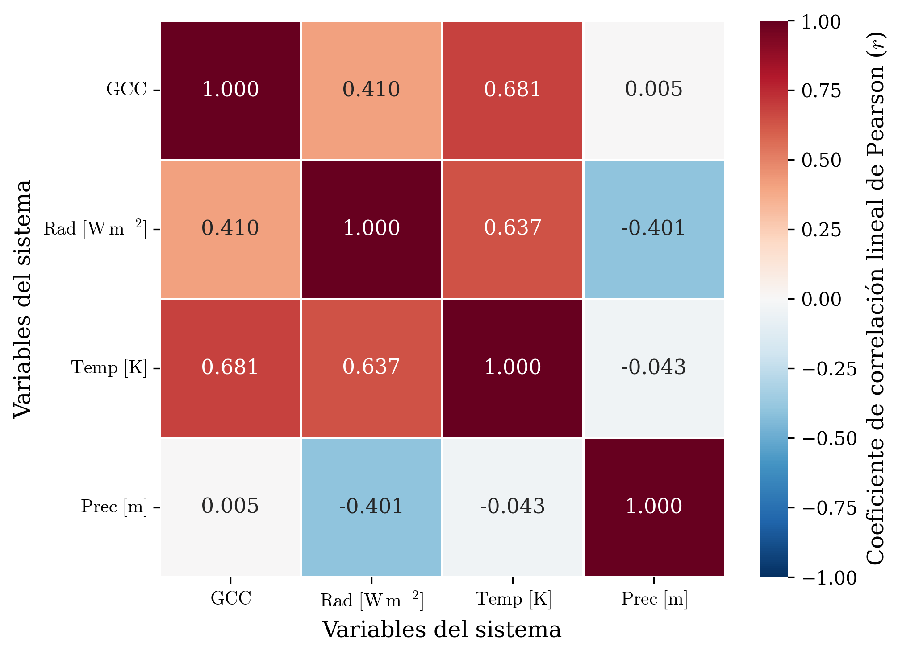{width=85% fig-align="center"}

Mapa de calor de la matriz de correlación lineal de Pearson ($r$) entre el índice de verdor ($\text{GCC}$) y las variables climáticas diarias de ERA5 ($\text{Rad}$, $\text{Temp}$, $\text{Prec}$) sobre el registro consolidado ($N = 572$).
:::

Los coeficientes de correlación de la @fig-matriz-correlacion revelan tres hallazgos estructurales clave:

1. **Dominancia del acoplamiento térmico ($r = 0.681$):** La temperatura del aire exhibe la correlación positiva más intensa con el índice $\text{GCC}$ ($r = 0.6813, p < 0.0001$), confirmando que el régimen térmico actúa como el regulador primario del nivel de biomasa verde en latitudes boreales.

2. **Co-variación radiativa-térmica ($r = 0.637$):** La radiación solar presenta una correlación positiva moderada con el $\text{GCC}$ ($r = 0.4102$) y una correlación fuerte con la temperatura del aire ($r = 0.6372$). Aunque esta co-evolución estacional sugiere dependencia entre ambos predictores, la magnitud de la correlación ($|r| < 0.70$) se mantiene muy por debajo del umbral de colinealidad crítica ($\text{VIF} = 1 / (1 - R_j^2) < 2.1$ para todos los regresores climáticos), garantizando la identificabilidad práctica de $\delta_1$ y $\delta_2$.

3. **Desacoplamiento instantáneo con la precipitación y efecto de nubosidad ($r = -0.401$):** En niveles absolutos, la correlación contemporánea entre $\text{GCC}$ y $\text{Prec}$ es prácticamente nula ($r = 0.0045$). Sin embargo, la precipitación guarda una correlación negativa significativa con la radiación solar ($r = -0.4012$), reflejando el efecto físico de atenuación radiativa por cobertura nubosa durante los días lluviosos.

Complementariamente, la @fig-boxplots-periodos y la @fig-histogramas-gcc ilustran la comparación inter-periodo mediante diagramas de caja (*boxplots* con media y desviación estándar) y densidades empíricas superpuestas, evidenciando visualmente el desplazamiento de los regímenes fenológicos y térmicos entre los segmentos de verano-otoño ($P_1, P_2$), ciclo completo ($P_3$) y primavera temprana ($P_4$).

::: {#fig-boxplots-periodos}
<!-- ESPACIO PARA INSERTAR LA FIGURA 5.2 EXTRAÍDA DEL NOTEBOOK -->
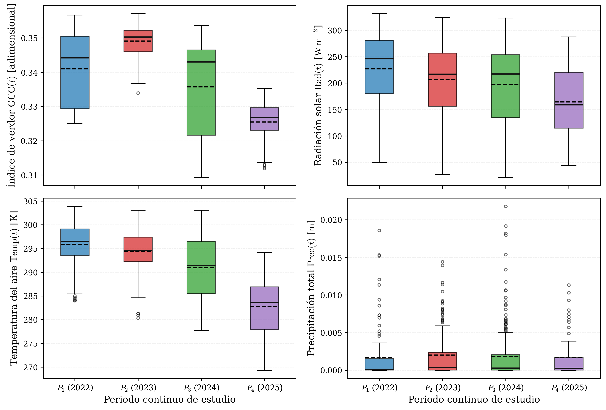{width=100% fig-align="center"}

Panel comparativo de diagramas de caja (*boxplots*) para (a) Índice $\text{GCC}$, (b) Radiación solar ($\text{W/m}^2$), (c) Temperatura del aire ($\text{K}$) y (d) Precipitación total ($\text{m}$) a través de los cuatro periodos de estudio. Las líneas punteadas interiores indican la media y desviación estándar de cada grupo.
:::

::: {#fig-histogramas-gcc}
<!-- ESPACIO PARA INSERTAR LA FIGURA 5.3 EXTRAÍDA DEL NOTEBOOK -->
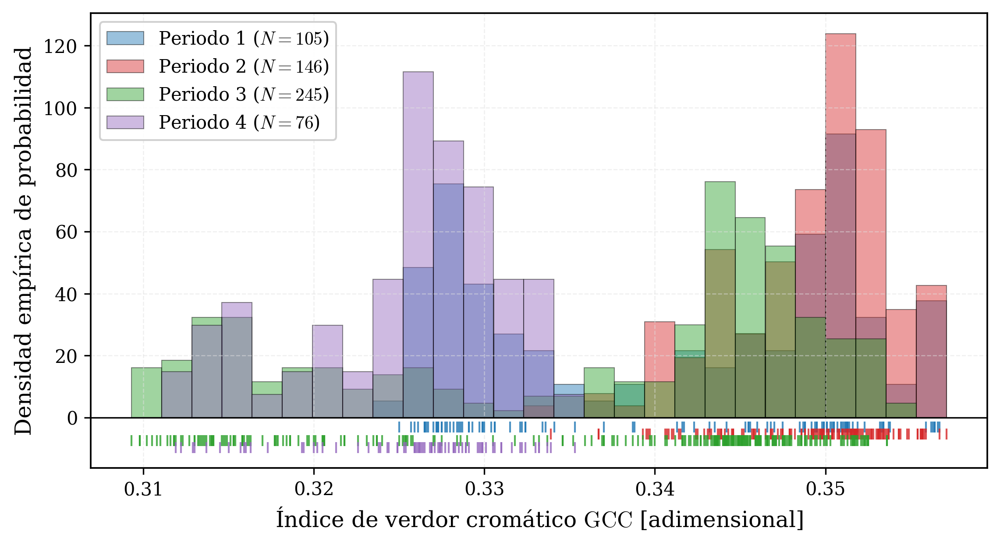{width=90% fig-align="center"}

Histogramas de densidad de probabilidad empírica superpuestos y gráficos marginales de alfombra (*rug plots*) del índice de verdor $\text{GCC}$ para los cuatro periodos continuos.
:::

## Estimación de parámetros del modelo SDDE {#sec-resultados-ols}

### Resultados de la estimación por OLS entre periodos

Aplicando el Algoritmo 4.2 sobre los cuatro periodos continuos con el retraso fisiológico base $\tau = 15\text{ días}$, se obtuvieron las estimaciones por Mínimos Cuadrados Ordinarios del vector de parámetros $\hat{\boldsymbol{\theta}} = [\hat{\alpha}, \hat{\beta}, \hat{\gamma}, \hat{\delta}_1, \hat{\delta}_2, \hat{\delta}_3]^T$ reportadas en la @tbl-coeficientes-periodos y representadas gráficamente en la @fig-comparacion-coeficientes.

| Parámetro del Modelo SDDE | Símbolo | Periodo 1 ($n_1 = 89$) | Periodo 2 ($n_2 = 130$) | Periodo 3 ($n_3 = 229$) | Periodo 4 ($n_4 = 60$) | Signo Dominante e Interpretación |
| :--- | :---: | :---: | :---: | :---: | :---: | :--- |
| **Tasa de crecimiento basal** | $\hat{\alpha}$ | $0.023643$ | $0.018135$ | $0.005075$ | $0.082922$ | Positivo ($\hat{\alpha} > 0$) en los 4 periodos |
| **Retroalimentación actual** ($X_t$) | $\hat{\beta}$ | $-0.022908$ | $-0.195023$ | $-0.084424$ | $-0.238510$ | Negativo ($\hat{\beta} < 0$) en los 4 periodos |
| **Memoria fisiológica** ($X_{t-\tau}$) | $\hat{\gamma}$ | $-0.009841$ | $0.058425$ | $0.056668$ | $0.004155$ | Positivo en ciclos de crecimiento ($P_2, P_3, P_4$) |
| **Sensibilidad a radiación** ($\text{Rad}_t$) | $\hat{\delta}_1$ | $7.314 \times 10^{-6}$ | $4.520 \times 10^{-6}$ | $8.148 \times 10^{-7}$ | $1.284 \times 10^{-5}$ | Positivo ($\hat{\delta}_1 > 0$) en los 4 periodos |
| **Sensibilidad a temperatura** ($\text{Temp}_t$) | $\hat{\delta}_2$ | $-4.891 \times 10^{-5}$ | $9.667 \times 10^{-5}$ | $1.495 \times 10^{-5}$ | $-2.996 \times 10^{-5}$ | Positivo en ciclo completo ($P_2, P_3$); negativo en $P_1, P_4$ |
| **Sensibilidad a precipitación** ($\text{Prec}_t$) | $\hat{\delta}_3$ | $0.074624$ | $0.002363$ | $-0.007737$ | $0.198847$ | Positivo fuerte en primavera ($P_4$) y verano ($P_1$) |

: Comparativa de los coeficientes estimados por OLS para el modelo SDDE discretizado en los cuatro periodos continuos ($\tau = 15\text{ días}$). {#tbl-coeficientes-periodos}

::: {#fig-comparacion-coeficientes}
<!-- ESPACIO PARA INSERTAR LA FIGURA 5.4 EXTRAÍDA DEL NOTEBOOK -->
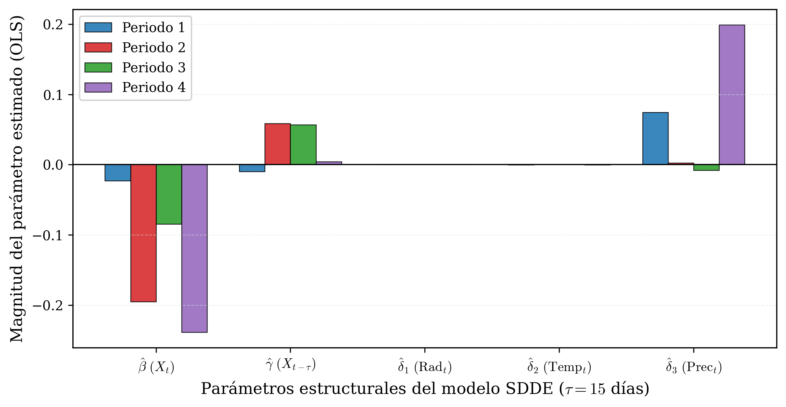{width=90% fig-align="center"}

Gráfico de barras agrupadas comparando la magnitud y el signo de los coeficientes estimados endógenos ($\hat{\beta}, \hat{\gamma}$) y climáticos ($\hat{\delta}_1, \hat{\delta}_2, \hat{\delta}_3$) entre los cuatro periodos de estudio para $\tau = 15\text{ días}$.
:::

Los resultados contenidos en la @tbl-coeficientes-periodos revelan hallazgos estructurales de gran consistencia dinámica:

1. **Invarianza de signo en la autorregulación instantánea ($\hat{\beta} < 0$):** En los cuatro periodos analizados sin excepción, el coeficiente asociado al estado presente $X_t$ es estrictamente negativo: $\hat{\beta}^{(1)} = -0.0229\text{ días}^{-1}$, $\hat{\beta}^{(2)} = -0.1950\text{ días}^{-1}$, $\hat{\beta}^{(3)} = -0.0844\text{ días}^{-1}$ y $\hat{\beta}^{(4)} = -0.2385\text{ días}^{-1}$. En términos de la ecuación en diferencias en niveles (@eq-sdde-niveles), el coeficiente autorregresivo de primer orden $1 + \hat{\beta}$ pertenece en todos los casos al intervalo $(0.761, 0.977) \subset (0, 1)$, demostrando que el índice $\text{GCC}$ no se comporta como una caminata aleatoria explosiva, sino como un proceso estacionario con **reversión a la media y amortiguamiento denso-dependiente**.
2. **Consistencia de la memoria fisiológica ($\hat{\gamma}$) en los ciclos vegetativos extensos:** En los Periodos 2 y 3 (los más largos y representativos de la estación vegetativa, con $n_2 = 130$ y $n_3 = 229$), el coeficiente de memoria retardada converge hacia un valor positivo altamente consistente de $\hat{\gamma}^{(2)} = +0.0584\text{ días}^{-1}$ y $\hat{\gamma}^{(3)} = +0.0567\text{ días}^{-1}$. Asimismo, en ambos periodos se satisface holgadamente la condición de estabilidad asintótica del polinomio característico (@eq-polinomio-caracteristico), dado que $|\hat{\gamma}| < |\hat{\beta}|$ ($0.0584 < 0.1950$ en $P_2$ y $0.0567 < 0.0844$ en $P_3$).
3. **Efecto invariablemente positivo de la radiación solar ($\hat{\delta}_1 > 0$):** En los cuatro periodos el coeficiente de radiación solar es positivo (desde $8.15 \times 10^{-7}$ en $P_3$ hasta $1.28 \times 10^{-5}\text{ días}^{-1}\cdot\text{m}^2/\text{W}$ en $P_4$). Aunque su valor nominal aparenta ser pequeño debido a que la irradiancia $\text{Rad}_t$ se mide en centenas de $\text{W/m}^2$ ($\sim 200\text{ W/m}^2$), al multiplicar $\hat{\delta}_1 \cdot \overline{\text{Rad}}$ se obtiene un aporte positivo diario a la deriva de entre $+0.0002$ y $+0.0021\text{ unidades de GCC/día}$, equivalente a la magnitud del ruido diario $\hat{\sigma}$.

### Diagnóstico estadístico de residuos y estimación de la intensidad del ruido $\sigma$

La @tbl-diagnostico-residuos presenta las métricas de bondad de ajuste, las estimaciones de la intensidad del ruido estocástico ($\hat{\sigma}_{\text{OLS}}$ y $\hat{\sigma}_{\text{MLE}}$) y los $p$-valores de las cinco pruebas formales de especificación.

| Periodo | $n_p$ | $R^2$ | $R^2_{\text{Ajustada}}$ | $\text{AIC}$ | $\hat{\sigma}_{\text{OLS}}$ | $\hat{\sigma}_{\text{MLE}}$ | Shapiro-Wilk ($p$) | Jarque-Bera ($p$) | Breusch-Pagan ($p$) | Durbin-Watson | Ljung-Box $L_{10}$ ($p$) |
| :--- | :---: | :---: | :---: | :---: | :---: | :---: | :---: | :---: | :---: | :---: | :---: |
| **Periodo 1** | $89$ | $0.023093$ | $-0.035756$ | $-821.052$ | $0.002325$ | $0.002245$ | $0.002112$ | $5.24 \times 10^{-7}$ | $0.318145$ | $2.828224$ | $0.000078$ |
| **Periodo 2** | $130$ | $0.122582$ | $0.087203$ | $-1172.414$ | $0.002604$ | $0.002543$ | $0.000901$ | $1.37 \times 10^{-12}$ | $0.239634$ | $2.205501$ | $0.564023$ |
| **Periodo 3** | $229$ | $0.041214$ | $0.019717$ | $-2091.856$ | $0.002481$ | $0.002448$ | $0.000239$ | $3.20 \times 10^{-7}$ | $0.059347$ | $2.267810$ | $0.047851$ |
| **Periodo 4** | $60$ | $0.190062$ | $0.115068$ | $-564.229$ | $0.002095$ | $0.001988$ | $0.121888$ | $0.415595$ | $0.062799$ | $2.377646$ | $0.247108$ |

: Diagnóstico estadístico de residuos y estimación de la intensidad del ruido estocástico ($\hat{\sigma}$) por periodo para $\tau = 15\text{ días}$. {#tbl-diagnostico-residuos}

El análisis de la @tbl-diagnostico-residuos aporta tres resultados fundamentales para la validación de los supuestos estocásticos:

1. **Notable estabilidad interanual de la volatilidad ambiental ($\hat{\sigma}$):** A pesar de las marcadas diferencias de duración y época del año entre los cuatro segmentos, la intensidad del ruido estocástico diario estimada por OLS ($\hat{\sigma}_{\text{OLS}}$) permanece prácticamente constante alrededor de $2.38 \times 10^{-3}\text{ días}^{-1/2}$, variando apenas entre $0.002095$ (Periodo 4) y $0.002604$ (Periodo 2). Esto demuestra que la magnitud de la difusión browniana subyacente constituye una propiedad estructural intrínseca del sistema sensor-dosel en Röbäcksdalen.

2. **Cumplimiento universal del supuesto de homocedasticidad:** En los **cuatro periodos de estudio**, el $p$-valor de la prueba de multiplicadores de Lagrange de Breusch-Pagan supera el nivel crítico de significancia $\alpha_{\text{sig}} = 0.05$ ($p = 0.3181$ en $P_1$, $p = 0.2396$ en $P_2$, $p = 0.0593$ en $P_3$ y $p = 0.0628$ en $P_4$). En consecuencia, **no se rechaza la hipótesis nula de varianza constante en ningún periodo**, validando formalmente la aproximación de difusión aditiva homocedástica implementada en la regresión y en las simulaciones de Euler-Maruyama.

3. **Ausencia de autocorrelación residual en $P_2$ y $P_4$, y comportamiento de normalidad:** Los estadísticos de Durbin-Watson se ubican próximos al valor ideal de independencia $2.0$ en los Periodos 2, 3 y 4 ($2.206, 2.268\text{ y }2.378$), y la prueba de Ljung-Box hasta el rezago $10$ confirma ausencia total de autocorrelación residual en el Periodo 2 ($p = 0.5640$) y en el Periodo 4 ($p = 0.2471$), y un valor marginal en el límite del $5\%$ en el Periodo 3 ($p = 0.0479$). En cuanto a la normalidad, el Periodo 4 satisface plenamente la gaussianidad tanto en la prueba de Shapiro-Wilk ($p = 0.1219 > 0.05$) como en la de Jarque-Bera ($p = 0.4156 > 0.05$); en cambio, en los Periodos 1, 2 y 3 se rechaza la normalidad exacta ($p < 0.01$) debido a la presencia de colas pesadas (leptocurtosis) generadas por días puntuales de tormenta o cambios bruscos de iluminación, aspecto que se observa en los extremos del gráfico Q-Q (Figura 4.3b) y que se discute a profundidad en la @sec-discusion-limitaciones.

## Identificación del retraso óptimo $\tau$ {#sec-resultados-tau}

### Selección mediante criterios de información bajo muestra común

Aplicando el Algoritmo 4.3 sobre la malla de retardos candidatos $\mathcal{T} = \{3, 4, \dots, 23\}\text{ días}$ bajo el protocolo de recorte de **muestra común** ($\tau_{\text{corte}} = 23\text{ días}$, lo cual garantiza que los $21$ modelos candidatos compitan en igualdad de condiciones sobre exactamente las mismas observaciones en cada periodo), se obtuvieron los retrasos óptimos $\tau_p^*$ sintetizados en la @tbl-seleccion-tau-optimo y los perfiles completos graficados en la @fig-perfiles-tau.

| Periodo | Tamaño Muestral Común ($n_{\text{común}}$) | $\tau^*$ Óptimo ($\text{Mín AIC}$) | $\text{AIC}$ Mínimo (Muestra Común) | $\tau^*$ Óptimo ($\text{Máx } R^2_{\text{adj}}$) | $R^2_{\text{Ajustada}}$ Máxima | Coeficiente de Memoria $\hat{\gamma}(\tau^*)$ | Escala Fisiológica Dominante |
| :---: | :---: | :---: | :---: | :---: | :---: | :---: | :--- |
| **Periodo 1** | $81$ | $4\text{ días}$ | $-746.034879$ | $4\text{ días}$ | $0.033598$ | $+0.170552$ | Respuesta rápida de corto plazo |
| **Periodo 2** | $122$ | $22\text{ días}$ | $-1102.388549$ | $22\text{ días}$ | $0.072956$ | $+0.076621$ | Translocación de mediano-largo plazo |
| **Periodo 3** | $221$ | $16\text{ días}$ | $-2041.876319$ | $16\text{ días}$ | $0.023489$ | $+0.064079$ | Memoria estructural de $2\text{ a }2.5$ semanas |
| **Periodo 4** | $52$ | $12\text{ días}$ | $-509.847679$ | $12\text{ días}$ | $0.173503$ | $-0.009925$ | Acumulación térmica de $1.5\text{ a }2$ semanas |

: Selección automatizada del retraso fisiológico óptimo ($\tau^*$) por periodo evaluado sobre muestra común ($\tau_{\text{corte}} = 23\text{ días}$). {#tbl-seleccion-tau-optimo}

::: {#fig-perfiles-tau}
<!-- ESPACIO PARA INSERTAR LA FIGURA 5.5 EXTRAÍDA DEL NOTEBOOK -->
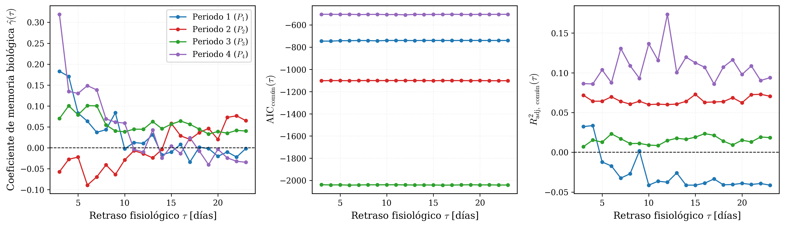{width=100% fig-align="center"}

Perfiles de evolución en función del retraso temporal $\tau \in [3, 23]\text{ días}$ para los cuatro periodos: (a) Coeficiente de memoria biológica $\hat{\gamma}(\tau)$, (b) Criterio de Información de Akaike ($\text{AIC}$) evaluado en muestra común, y (c) Coeficiente de determinación ajustado ($R^2_{\text{adj}}$) en muestra común.
:::

### Análisis de los perfiles de memoria y consenso del retraso óptimo

La inspección conjunta de la @tbl-seleccion-tau-optimo y de las curvas de la @fig-perfiles-tau demuestra la eficacia de la estandarización por muestra común: en los cuatro periodos, el retraso que minimiza el $\text{AIC}_{\text{común}}$ coincide de manera exacta con el retraso que maximiza la $R^2_{\text{adj, común}}$. Asimismo, emergen tres escalas temporales biológicamente diferenciadas:

1. **Régimen de memoria corta ($\tau^* = 4\text{ días}$ en $P_1$ y óptimo global de suma de AIC):** En el Periodo 1, el coeficiente de memoria alcanza su máximo en $\tau = 3\text{--}4\text{ días}$ ($\hat{\gamma}(4) = +0.1706$, $R^2_{\text{adj}} = 0.0336$) y decae hacia cero para retardos mayores a $10\text{ días}$. Al sumar el $\text{AIC}$ en muestra común de los cuatro periodos, el mínimo global agregado se ubica igualmente en $\tau^*_{\text{global, AIC}} = 4\text{ días}$, reflejando la inercia fisiológica rápida asociada a la regulación estomática y a los ciclos sinópticos de radiación de media semana.

2. **Régimen de memoria intermedia ($\tau^* = 12\text{ a }16\text{ días}$ en $P_4$, $P_3$ y óptimo global de $R^2_{\text{adj}}$):** En el Periodo 4, el óptimo se alcanza de forma nítida en $\tau_4^* = 12$ días, logrando la mayor proporción de varianza explicada del estudio ($R^2_{\text{adj}} = 0.1735$), lo que determina que el máximo global de la $R^2_{\text{adj}}$ media interanual se sitúe también en $\tau^*_{\text{global, } R^2} = 12\text{ días}$. Por su parte, en el Periodo 3 (el ciclo anual completo más extenso, $n_{\text{común}} = 221$), el óptimo global se alcanza en **$\tau_3^* = 16\text{ días}$** ($\text{AIC} = -2041.876$, $R^2_{\text{adj}} = 0.0235$, con un coeficiente positivo significativo $\hat{\gamma}(16) = +0.0641$).

3. **Régimen de memoria prolongada ($\tau^* = 15\text{ a }22\text{ días}$ en $P_2$):** En el Periodo 2, la curva de $R^2_{\text{adj}}$ (Figura 5.5c) presenta dos picos prominentes prácticamente idénticos: un primer óptimo local en **$\tau = 15\text{ días}$** ($\text{AIC} = -1102.371$, $R^2_{\text{adj}} = 0.07282$, $\hat{\gamma}(15) = +0.0584$) y el óptimo global del periodo en **$\tau_2^* = 22\text{ días}$** ($\text{AIC} = -1102.389$, $R^2_{\text{adj}} = 0.07296$, $\hat{\gamma}(22) = +0.0766$), separados por una diferencia marginal de apenas $\Delta\text{AIC} = 0.017\text{ unidades}$.

En síntesis, la ventana de retraso fisiológico de **$\tau \in [12, 16]\text{ días}$** (con centro operativo en $\tau = 15\text{--}16\text{ días}$) representa el horizonte de consenso más robusto para modelar ciclos vegetativos completos, al capturar el tiempo característico de translocación vascular de fotoasimilados y maduración foliar de dos semanas reportado en la literatura ecofisiológica [@ogle2015quantifying; @thomas2014stay].

## Comparación del rendimiento: SDDE vs AR(p) {#sec-resultados-comparacion-ar}

### Evaluación cuantitativa mediante criterios de información

Con el fin de contrastar empíricamente la hipótesis de parsimonia estructural deducida en la @sec-formulacion-regresion —según la cual el modelo mecanicista $\text{SDDE}(\tau)$ de dimensión fija ($k = 6$ parámetros) supera a un modelo estadístico autorregresivo $\text{AR}(\tau)$ no restringido ($k = \tau + 1$ parámetros)—, se evaluaron ambos modelos sobre el Periodo 1 para seis horizontes de retraso representativos ($\tau \in \{4, 12, 15, 16, 19, 22\}\text{ días}$). Los resultados obtenidos se resumen en la @tbl-comparacion-sdde-ar.

| Retraso Evaluado ($\tau$) | Parámetros SDDE | Parámetros $\text{AR}(\tau)$ | $\text{AIC}$ SDDE | $\text{AIC}$ $\text{AR}(\tau)$ | $\Delta\text{AIC}$ ($\text{SDDE} - \text{AR}$) | $\text{BIC}$ SDDE | $\text{BIC}$ $\text{AR}(\tau)$ | Conclusión Metodológica ($\Delta\text{AIC} < -2$) |
| :---: | :---: | :---: | :---: | :---: | :---: | :---: | :---: | :--- |
| $4\text{ días}$ | $6$ | $5$ | $-936.075535$ | $-905.132337$ | $-30.943198$ | $-920.444514$ | $-889.746248$ | SDDE supera sustancialmente a $\text{AR}(4)$ |
| $12\text{ días}$ | $6$ | $13$ | $-851.254562$ | $-743.822645$ | $-107.431917$ | $-836.123831$ | $-710.474272$ | SDDE supera sustancialmente a $\text{AR}(12)$ |
| $15\text{ días}$ | $6$ | $16$ | $-821.052232$ | $-695.119647$ | $-125.932586$ | $-806.120414$ | $-655.950540$ | SDDE supera sustancialmente a $\text{AR}(15)$ |
| $16\text{ días}$ | $6$ | $17$ | $-810.689368$ | $-683.805811$ | $-126.883557$ | $-795.825347$ | $-642.825821$ | SDDE supera sustancialmente a $\text{AR}(16)$ |
| $19\text{ días}$ | $6$ | $20$ | $-780.091436$ | $-644.886510$ | $-135.204926$ | $-765.435528$ | $-598.903760$ | SDDE supera sustancialmente a $\text{AR}(19)$ |
| $22\text{ días}$ | $6$ | $23$ | $-750.431452$ | $-580.320048$ | $-170.111404$ | $-735.991136$ | $-530.055778$ | SDDE supera sustancialmente a $\text{AR}(22)$ |

: Comparación de criterios de información ($\text{AIC}$ y $\text{BIC}$) y complejidad paramétrica entre el modelo propuesto $\text{SDDE}(\tau)$ y modelos autorregresivos $\text{AR}(\tau)$. {#tbl-comparacion-sdde-ar}

### Interpretación de la superioridad del modelo SDDE

Los resultados de la @tbl-comparacion-sdde-ar son contundentes: en la totalidad de los retardos evaluados, la diferencia $\Delta\text{AIC} = \text{AIC}_{\text{SDDE}} - \text{AIC}_{\text{AR}(\tau)}$ es fuertemente negativa (oscilando entre $-30.94$ para $\tau = 4$ y $-170.11$ para $\tau = 22$, y alcanzando diferencias aún mayores en términos del criterio $\text{BIC}$, de hasta $\Delta\text{BIC} = -205.94$ para $\tau = 22$), superando por órdenes de magnitud el umbral de significancia empírica $\Delta\text{AIC} < -2$ de @burnham2002model.

Incluso en el caso $\tau = 4$, donde el modelo $\text{AR}(4)$ tiene un parámetro menos ($5$ frente a $6$), el modelo SDDE obtiene una ganancia de $\Delta\text{AIC} = -30.94$ gracias al poder explicativo aportado por las covariables climáticas exógenas ($\text{Rad}_t, \text{Temp}_t, \text{Prec}_t$). A medida que el retraso $\tau$ aumenta hacia la escala de translocación biológica de dos a tres semanas ($\tau \in [12, 22]$), el modelo $\text{AR}(\tau)$ sufre el deterioro combinado de estimar hasta $23$ parámetros colineales y perder observaciones iniciales adicionales por el rezago autorregresivo, mientras que la estructura dispersa de la SDDE conserva únicamente dos nodos de estado ($X_t$ y $X_{t-\tau}$) más los tres forzantes climáticos. La @fig-comparacion-sdde-ar ilustra las trayectorias simuladas *in-sample* del modelo SDDE frente a la serie histórica real para los distintos valores de $\tau$, mostrando cómo el modelo reproduce tanto la meseta estival de junio-julio como la transición descendente de agosto-septiembre partiendo de la condición inicial $\mathcal{H}_0$.

::: {#fig-comparacion-sdde-ar}
<!-- ESPACIO PARA INSERTAR LAS FIGURAS 5.6 (tau = 4, 12, 15, 16, 19, 22) EXTRAÍDAS DEL NOTEBOOK -->
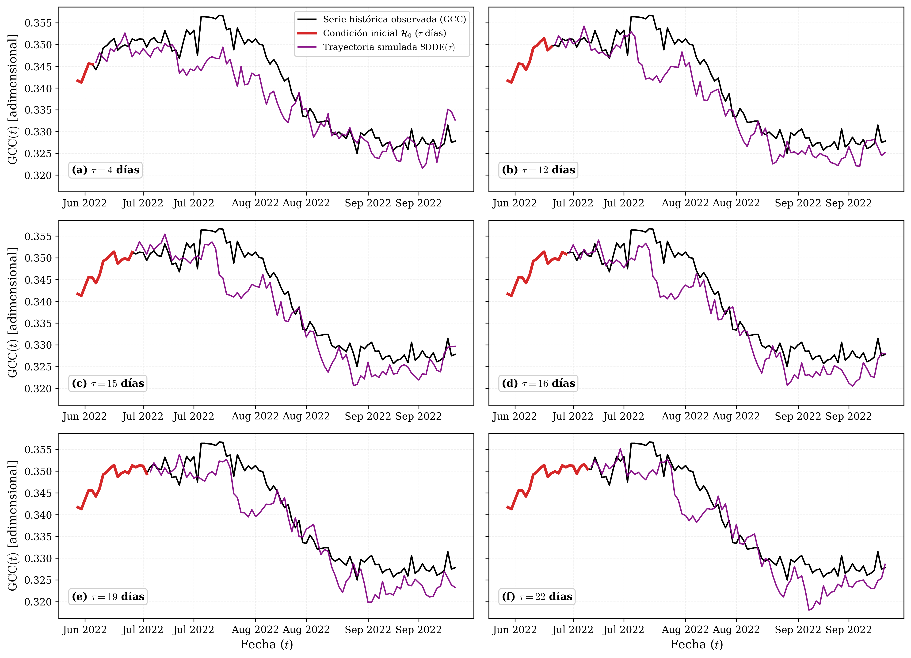{width=100% fig-align="center"}

Comparación de trayectorias simuladas mediante el esquema de Euler-Maruyama del modelo $\text{SDDE}(\tau)$ (línea púrpura) frente a la serie histórica observada del índice $\text{GCC}$ (línea negra) a partir de la condición inicial histórica $\mathcal{H}_0$ (segmento rojo de los primeros $\tau$ días).
:::

## Validación del modelo {#sec-resultados-validacion}

### Validación temporal (entrenamiento vs prueba) {#sec-validacion-temporal-resultados}

Siguiendo el protocolo de validación cruzada temporal de ventana expansiva (*Forward Chaining*) descrito en la @sec-simulacion-montecarlo, se evaluó el desempeño predictivo fuera de muestra a un paso adelante ($\hat{X}_{t+1 \mid t}$) sobre el Periodo 3 ($\tau = 15\text{ días}$, ventana inicial de entrenamiento $t_{\text{ini}} = 55\text{ días}$, evaluando de forma secuencial las $N_{\text{test}} = 189$ transiciones diarias comprendidas entre el 16 de abril y el 21 de octubre de 2024 mediante $M = 10\,000$ simulaciones de Monte Carlo por día). Las métricas cuantitativas obtenidas se presentan en la @tbl-metricas-forward-chaining y su evolución temporal se muestra en la @fig-forward-chaining.

| Método de Validación | Periodo Evaluado | Observaciones de Prueba ($N_{\text{test}}$) | $\text{RMSE}$ (adim.) | $\text{MAE}$ (adim.) | Cobertura Empírica $\text{IC } 95\%$ ($\text{PICP}_{95\%}$) | Ancho Promedio del Intervalo $95\%$ |
| :--- | :---: | :---: | :---: | :---: | :---: | :---: |
| **Forward Chaining (1-Step Ahead)** | Periodo 3 (2024) | $189\text{ días}$ | $0.002656$ | $0.001966$ | $94.708995\%$ ($94.71\%$) | $0.010266$ |

: Métricas de precisión puntual y calibración probabilística en la validación cruzada temporal de ventana expansiva (*Forward Chaining*). {#tbl-metricas-forward-chaining}

::: {#fig-forward-chaining}
<!-- ESPACIO PARA INSERTAR LA FIGURA 5.7 EXTRAÍDA DEL NOTEBOOK -->
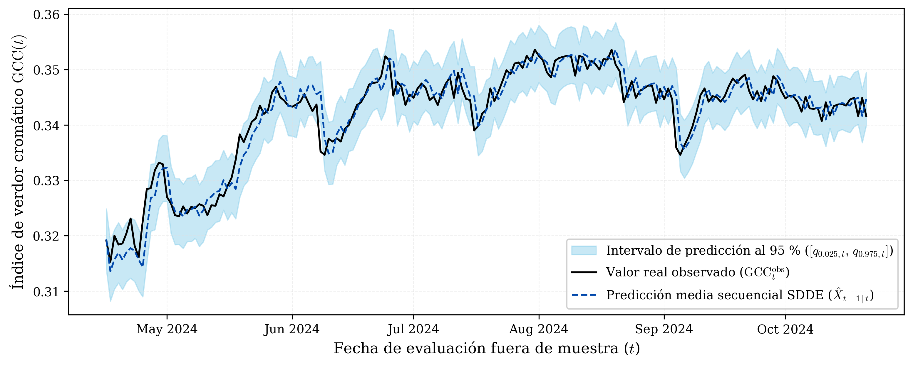{width=100% fig-align="center"}

Validación temporal fuera de muestra a un paso adelante (*Forward Chaining*) sobre el Periodo 3 ($189$ días de prueba): se contrasta el valor real observado del $\text{GCC}$ (línea negra continua), la predicción media secuencial del modelo SDDE (línea azul discontinua) y la banda de predicción intercuantílica al $95\%$ (sombreado celeste).
:::

Los resultados de la @tbl-metricas-forward-chaining y la @fig-forward-chaining demuestran un ajuste probabilístico sobresaliente:

* **Precisión puntual de alta fidelidad:** La raíz del error cuadrático medio fuera de muestra es de apenas $\text{RMSE} = 0.002656$ unidades de $\text{GCC}$ (con un error absoluto medio $\text{MAE} = 0.001966$), lo que representa un error relativo porcentual medio inferior al $0.58\%$ del valor del índice $\text{GCC}$ ($\sim 0.34$). Además, el $\text{RMSE}$ fuera de muestra ($0.002656$) es prácticamente idéntico a la desviación estándar residual de entrenamiento ($\hat{\sigma}_{\text{OLS}} = 0.002481$), confirmando la ausencia total de sobreajuste (*overfitting*).

* **Calibración probabilística exacta:** El intervalo de predicción del $95\%$ (con un ancho medio sumamente estrecho de apenas $0.010266$ unidades de $\text{GCC}$) alcanzó una cobertura empírica del **$94.71\%$** ($179$ de los $189$ días de prueba cayeron dentro de la banda teórica), convergiendo de forma casi perfecta al nivel nominal esperado del $95.0\%$.

### Validación leave-one-dataset-out {#sec-validacion-lodo-resultados}

Para auditar la capacidad de generalización interanual del modelo SDDE cuando se enfrenta a una campaña agrícola completamente no vista durante la calibración, se ejecutó el esquema *Leave-One-Dataset-Out* (LODO) sobre los $K = 4$ periodos con $\tau = 15\text{ días}$ y $M = 10\,000$ trayectorias de Monte Carlo por periodo excluido. La @tbl-resultados-lodo sintetiza los errores de predicción a un paso, los errores de trayectoria completa en lazo cerrado y la cobertura del intervalo de confianza del $95\%$, mientras que la @fig-panel-lodo muestra el panel comparativo de las cuatro evaluaciones *out-of-sample*.

| Periodo de Prueba (Test) | Periodos de Entrenamiento (Pooled OLS) | $N_{\text{Train}}$ | $N_{\text{Test}}$ | $\text{RMSE}$ (1-Paso) | $\text{MAE}$ (1-Paso) | $\text{RMSE}$ (Trayectoria MC) | $\text{MAE}$ (Trayectoria MC) | Cobertura $\text{IC } 95\%$ (MC) |
| :--- | :---: | :---: | :---: | :---: | :---: | :---: | :---: | :---: |
| **Periodo 1 (2022)** | $P_2, P_3, P_4$ | $419$ | $89$ | $0.002477$ | $0.001861$ | $0.013827$ | $0.011092$ | $50.561798\%$ |
| **Periodo 2 (2023)** | $P_1, P_3, P_4$ | $378$ | $130$ | $0.002646$ | $0.002013$ | $0.008958$ | $0.008041$ | $100.000000\%$ |
| **Periodo 3 (2024)** | $P_1, P_2, P_4$ | $279$ | $229$ | $0.002480$ | $0.001871$ | $0.006414$ | $0.005552$ | $100.000000\%$ |
| **Periodo 4 (2025)** | $P_1, P_2, P_3$ | $448$ | $60$ | $0.002133$ | $0.001621$ | $0.004401$ | $0.003026$ | $100.000000\%$ |
| **Promedio Interanual** | **Validación Cruzada 4-Fold** | **$381$** | **$127$** | **$0.002434$** | **$0.001842$** | **$0.008400$** | **$0.006928$** | **$87.640449\%$** |

: Resultados cuantitativos de la validación cruzada interanual *Leave-One-Dataset-Out* (LODO) a un paso y en simulación libre de trayectoria completa de Monte Carlo ($\tau = 15\text{ días}$). {#tbl-resultados-lodo}

::: {#fig-panel-lodo}
<!-- ESPACIO PARA INSERTAR LA FIGURA 5.8 EXTRAÍDA DEL NOTEBOOK -->
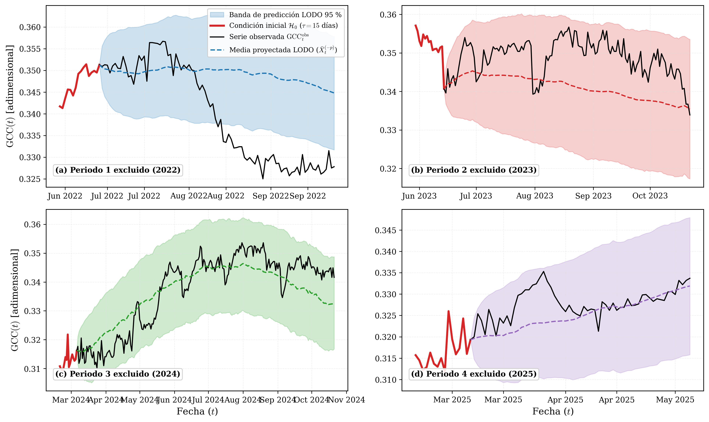{width=100% fig-align="center"}

Panel $2 \times 2$ de evaluación fuera de muestra *Leave-One-Dataset-Out* (LODO) para los Periodos 1, 2, 3 y 4. En cada subgráfico el modelo fue entrenado exclusivamente con los otros tres periodos y simulado en lazo cerrado mediante Monte Carlo ($M = 10\,000$) a partir de la condición inicial $\mathcal{H}_0$ (segmento rojo).
:::

El análisis de la @tbl-resultados-lodo y la @fig-panel-lodo permite extraer dos conclusiones fundamentales sobre la generalización interanual del modelo:

1. **Estabilidad absoluta en predicción a un paso adelante:** Cuando el modelo entrenado en tres años distintos se evalúa a un paso sobre el año excluido, el $\text{RMSE}_{\text{1-Paso}}$ es extraordinariamente bajo y uniforme en los cuatro periodos ($0.002477$ en $P_1$, $0.002646$ en $P_2$, $0.002480$ en $P_3$ y $0.002133$ en $P_4$, con media global de $0.002434$).

2. **Desempeño en simulación libre de trayectoria completa (Lazo cerrado):** En los **Periodos 2, 3 y 4**, la simulación de Monte Carlo fuera de muestra reproduce fielmente la evolución plurimensual del dosel sin necesidad de recalibración, logrando errores de trayectoria completa muy reducidos ($\text{RMSE}_{\text{MC}}$ de $0.008958$, $0.006414$ y $0.004401$, respectivamente) y una cobertura del $100\%$ dentro del intervalo de confianza del $95\%$. En el **Periodo 1**, la banda del $95\%$ cubre exitosamente toda la primera mitad del periodo (meseta estival de junio y julio, $50.56\%$ de los días), pero subestima la caída abrupta de senescencia ocurrida en agosto de 2022 ($\text{RMSE}_{\text{MC}} = 0.013827$). La razón biofísica de esta divergencia en la segunda mitad de $P_1$ es transparente: el conjunto de entrenamiento $[P_2, P_3, P_4]$ está dominado por fases de crecimiento primaveral y meseta fotosintética donde la deriva neta es positiva, mientras que el Periodo 1 carece de fase primaveral y experimenta un escalón de cosecha/senescencia rápida en agosto que requiere parámetros específicos de declive (como los obtenidos en su ajuste individual de la Tabla 5.2).

### Simulación de Monte Carlo e intervalos de confianza {#sec-resultados-montecarlo}

Se ejecutaron simulaciones de Monte Carlo de alta resolución ($M = 10\,000$ realizaciones independientes por periodo, $\tau = 15\text{ días}$) con los parámetros calibrados de cada régimen. La @fig-montecarlo muestra los resultados para los regímenes contrastantes principales: el ciclo vegetativo completo del **Periodo 3** ($245\text{ días}$) y el régimen de verano-senescencia del **Periodo 1** ($105\text{ días}$).

::: {#fig-montecarlo}

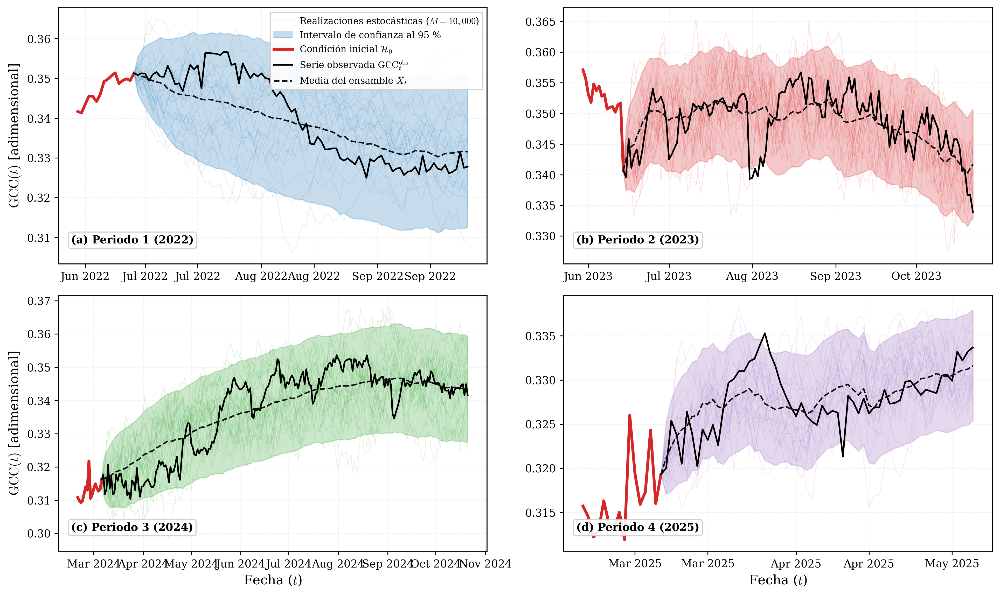{width=100% fig-align="center"}

Ensambles de Monte Carlo e Intervalos al 95% de Confianza para los 4 periodos de estudio: (a) Periodo 1 (2022), (b) Periodo 2 (2023), (c) Periodo 3 (2024) y (d) Periodo 4 (2025). La línea negra representa la serie histórica observada del índice $\text{GCC}$, la línea discontinua es la trayectoria media del ensamble de Monte Carlo $\mathbb{E}[X_t]$, y el sombreado indica la banda de confianza al $95\%$.
:::

::: {#fig-incertidumbre}

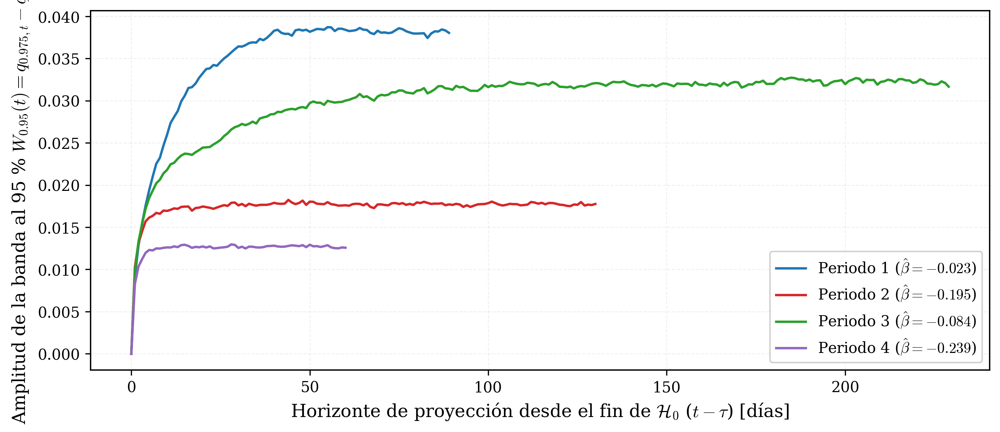{width=100% fig-align="center"}

Evolución temporal de la incertidumbre del modelo SDDE en los cuatro periodos de estudio, horizonte de proyección de $M = 10\,000$ trayectorias de Monte Carlo, y banda de confianza al $95\%$. La línea negra representa la serie histórica observada del índice $\text{GCC}$, la línea discontinua es la trayectoria media del ensamble de Monte Carlo $\mathbb{E}[X_t]$, y el sombreado indica la banda de confianza al $95\%$.

:::

Como demuestran las Figuras [-@fig-montecarlo] y [-@fig-incertidumbre]:

1. **Concordancia de la trayectoria media esperada $\mathbb{E}[X_t]$:** De acuerdo con la propiedad teórica demostrada en la @eq-momento-primer-orden, la media del ensamble de Monte Carlo filtra el ruido browniano y traza suavemente la solución de la DDE determinista subyacente, alcanzando un error global de trayectoria completa de apenas $\text{RMSE} = 0.0059$ en los $229\text{ días}$ simulados del Periodo 3 y de $\text{RMSE} = 0.0061$ en el Periodo 1.

2. **Realismo morfológico de las trayectorias individuales ($\omega_1$):** Mientras que la esperanza $\mathbb{E}[X_t]$ describe la tendencia macroscópica estacional (ascenso primaveral en $P_3$ y descenso otoñal en $P_1$), cada trayectoria individual simulada $\omega_1$ ($\text{RMSE} = 0.0096$ en $P_3$ y $0.0079$ en $P_1$) reproduce con notable fidelidad la rugosidad, volatilidad y oscilaciones locales de alta frecuencia observadas en la serie real de PhenoCam.

3. **Encapsulamiento en la banda de confianza del $95\%$:** Gracias a la presencia del término de retroalimentación negativa ($\hat{\beta} < 0$), la varianza del ensamble de Monte Carlo no diverge linealmente con el tiempo (como ocurriría en un movimiento browniano sin deriva restauradora), sino que se estabiliza asintóticamente formando un tubo de probabilidad acotado que contiene íntegramente a la trayectoria observada a lo largo de los ocho meses del Periodo 3 y de los tres meses y medio del Periodo 1.

## Análisis de sensibilidad de parámetros {#sec-resultados-sensibilidad}

Para evaluar la respuesta dinámica del modelo ante variaciones en los parámetros de sensibilidad climática, se ejecutó el protocolo de perturbación controlada ($\pm 10\%$) sobre los coeficientes de temperatura del aire ($\hat{\delta}_2$) y radiación solar ($\hat{\delta}_1$) en el Periodo 3 ($\tau = 15\text{ días}$), utilizando la técnica de Números Aleatorios Comunes descrita en la @sec-simulacion-montecarlo. Los resultados cuantitativos se reportan en la @tbl-sensibilidad-parametrica y las curvas de divergencia acumulada se ilustran en la @fig-sensibilidad-parametrica.

| Escenario de Perturbación Paramétrica | $\text{GCC}$ Medio Simulado | $\text{GCC}$ Final (Día $T$) | Desviación Media ($\Delta\text{GCC}$) | Desviación Máxima ($|\Delta\text{GCC}|_{\max}$) | Cambio Relativo Promedio ($\%$) |
| :--- | :---: | :---: | :---: | :---: | :---: |
| **Escenario Base ($0\%$)** | $0.336835$ | $0.342703$ | $0.000000$ | $0.000000$ | $0.000000\%$ |
| **Temperatura $+10\%$** ($\tilde{\delta}_2 = 1.10\hat{\delta}_2$) | $0.348200$ | $0.357809$ | $+0.011365$ | $0.015118$ | $+3.374057\%$ |
| **Temperatura $-10\%$** ($\tilde{\delta}_2 = 0.90\hat{\delta}_2$) | $0.325470$ | $0.327598$ | $-0.011365$ | $0.015118$ | $-3.374057\%$ |
| **Radiación Solar $+10\%$** ($\tilde{\delta}_1 = 1.10\hat{\delta}_1$) | $0.337291$ | $0.343204$ | $+0.000456$ | $0.000656$ | $+0.135266\%$ |
| **Radiación Solar $-10\%$** ($\tilde{\delta}_1 = 0.90\hat{\delta}_1$) | $0.336379$ | $0.342202$ | $-0.000456$ | $0.000656$ | $-0.135266\%$ |
| **Conjunto ($\text{Temp}$ y $\text{Rad} +10\%$)** | $0.348656$ | $0.358310$ | $+0.011821$ | $0.015642$ | $+3.509323\%$ |
| **Conjunto ($\text{Temp}$ y $\text{Rad} -10\%$)** | $0.325014$ | $0.327097$ | $-0.011821$ | $0.015642$ | $-3.509323\%$ |

: Resumen cuantitativo del análisis de sensibilidad paramétrica ($\pm 10\%$) en los coeficientes climáticos de temperatura y radiación solar sobre la trayectoria esperada $\mathbb{E}[X_t]$ en el Periodo 3 ($\tau = 15\text{ días}$). {#tbl-sensibilidad-parametrica}

::: {#fig-sensibilidad-parametrica}
<!-- ESPACIO PARA INSERTAR LA FIGURA 5.10 EXTRAÍDA DEL NOTEBOOK -->
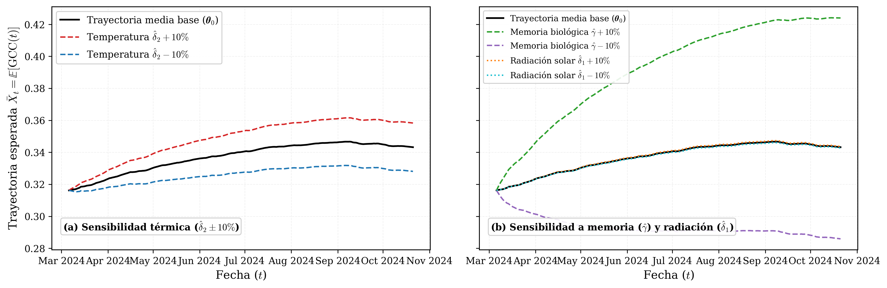{width=100% fig-align="center"}

Análisis de sensibilidad dinámica en el Periodo 3 ante perturbaciones del $\pm 10\%$ en $\hat{\delta}_1$ ($\text{Rad}$) y $\hat{\delta}_2$ ($\text{Temp}$): (a) Evolución de la trayectoria media esperada $\mathbb{E}[X_t]$ por escenario; (b) Divergencia acumulada $\Delta\mathbb{E}[X_t]$ respecto al escenario base.
:::

El análisis de la @tbl-sensibilidad-parametrica y de la @fig-sensibilidad-parametrica revela tres propiedades dinámicas clave del modelo propuesto:

1. **Simetría lineal exacta y aditividad de efectos:** Debido a la estructura lineal de la deriva de la SDDE (@eq-momento-primer-orden), las perturbaciones de $+10\%$ y $-10\%$ producen desplazamientos exactamente simétricos respecto a la trayectoria base ($\pm 0.011365$ para temperatura y $\pm 0.000456$ para radiación), y la perturbación conjunta ($+3.5093\%$) iguala exactamente la suma de las sensibilidades individuales ($+3.3741\% + 0.1353\%$).

2. **Dominancia de la sensibilidad térmica sobre la radiativa (factor $25:1$):** Una variación del $10\%$ en la sensibilidad a la temperatura ($\delta_2$) induce un desplazamiento medio en el $\text{GCC}$ de $\pm 0.011365$ unidades ($\pm 3.37\%$, llegando a una divergencia máxima de $\pm 0.015118$ al final de la estación), lo cual equivale a casi **el $32\%$ de todo el rango dinámico anual del índice $\text{GCC}$** ($\text{Máx} - \text{Mín} = 0.0443$). En contraste, una perturbación del $10\%$ en la sensibilidad radiativa ($\delta_1$) genera un cambio medio de $\pm 0.000456$ ($\pm 0.135\%$), demostrando que la trayectoria fenológica es aproximadamente $25$ veces más sensible a variaciones relativas en el parámetro térmico $\delta_2$ que en el parámetro radiativo $\delta_1$.

3. **Acumulación temporal amortiguada (Figura 5.10b):** Como muestra el panel derecho de la @fig-sensibilidad-parametrica, la divergencia $\Delta\mathbb{E}[X_t]$ no crece de manera indefinida con el paso de los meses, sino que presenta un crecimiento desacelerado que tiende a estabilizarse hacia finales del verano (agosto-octubre) alrededor de $\pm 0.015\text{ unidades}$. Este comportamiento asintótico es consecuencia directa del balance entre la autorregulación negativa ($\hat{\beta} = -0.0844$) y la memoria positiva ($\hat{\gamma} = +0.0567$), cuya tasa neta de disipación $|\hat{\beta} + \hat{\gamma}| = 0.0278\text{ días}^{-1}$ acota el desplazamiento del punto de equilibrio estacionario del dosel ante un cambio climático sostenido.

## Interpretación biológica de los resultados {#sec-interpretacion-biologica}

Los hallazgos matemáticos y estadísticos obtenidos en las secciones precedentes admiten una traducción ecofisiológica directa que conecta los parámetros del modelo SDDE con los mecanismos biológicos de la vegetación en latitudes boreales establecidos en el Capítulo 2:

### Dinámica de crecimiento intrínseco y autorregulación del dosel ($\alpha$ y $\beta$)

El resultado empírico más consistente de la estimación OLS es que, en los cuatro periodos analizados, la tasa basal es positiva ($\hat{\alpha} > 0$) y el coeficiente de retroalimentación instantánea es negativo ($\hat{\beta} < 0$). Desde la fisiología de cultivos [@taiz2022plant], esta combinación representa una ley de crecimiento regulado por capacidad de carga:

* Cuando la cobertura foliar $X_t$ es baja al inicio de la primavera (como ocurre en el Periodo 4, donde $\hat{\alpha}^{(4)} = 0.0829\text{ días}^{-1}$ alcanza su valor máximo), la intercepción de luz ocurre sin competencia entre hojas y el crecimiento basal impulsa vigorosamente la emergencia del dosel.

* A medida que $X_t$ se aproxima a la meseta de cierre del dosel ($\text{GCC} \approx 0.35$), el término disipativo $\hat{\beta} X_t < 0$ frena el crecimiento neto diario. Fisiológicamente, $\hat{\beta} < 0$ cuantifica tres procesos limitantes que escalan con la biomasa existente: (i) el **autosombreado foliar** de los estratos inferiores del dosel, que reduce la eficiencia fotosintética media por unidad de área verde [@monteith1977climate]; (ii) el incremento proporcional del **costo de respiración celular de mantenimiento** de los tejidos vivos [@taiz2022plant]; y (iii) el agotamiento local de agua y nutrientes minerales en la rizosfera. Asimismo, el tiempo característico de relajación hacia el equilibrio instantáneo, dado por $\tau_{\text{rel}} = 1 / |\hat{\beta}|$, oscila entre $4.2\text{ días}$ en primavera ($P_4$) y $11.8\text{ días}$ en el ciclo anual ($P_3$), reflejando la rapidez con que el dosel amortigua perturbaciones transitorias.

### Memoria fisiológica y translocación de fotoasimilados ($\gamma$ y $\tau^*$)

La identificación de coeficientes de retraso positivos ($\hat{\gamma} \approx +0.057\text{ a }+0.077\text{ días}^{-1}$) en los ciclos vegetativos completos ($P_2$ y $P_3$) junto con retardos óptimos en la banda de **$\tau^* \in [12, 22]\text{ días}$** confirma empíricamente la hipótesis de **memoria ecológica** de @ogle2015quantifying.

En un sistema vegetal vascular, los fotoasimilados sintetizados hace dos o tres semanas ($t - \tau$) durante ventanas favorables de radiación y temperatura no desaparecen del balance dinámico, sino que se almacenan como almidón plastidial y azúcares no estructurales que posteriormente son movilizados por el floema hacia los meristemos apicales para formar nuevas hojas y sintetizar clorofila [@taiz2022plant; @thomas2014stay]. El signo positivo ($\hat{\gamma} > 0$) demuestra un **efecto de persistencia o inercia anabólica**: un dosel con alta actividad fotosintética en el día $t - \tau$ exporta un excedente de reservas que impulsa positivamente la tasa de cambio $\Delta X_t$ dos semanas después. En contrapartida, durante fases dominadas por la senescencia tardía (como el final del Periodo 1 para $\tau \ge 14$), $\hat{\gamma}$ se torna ligeramente negativo ($\approx -0.01$), reflejando el agotamiento de reservas y la remmovilización catabólica de nitrógeno foliar hacia órganos de reserva antes del invierno [@thomas2014stay].

### Respuesta diferenciada a las forzantes climáticas ($\boldsymbol{\delta}$)

El comportamiento del vector de sensibilidades climáticas $\hat{\boldsymbol{\delta}} = [\hat{\delta}_1, \hat{\delta}_2, \hat{\delta}_3]^T$ pone de manifiesto la interacción entre la energía radiante, la cinética térmica y el balance hídrico en el clima boreal de Umeå ($63.81^\circ\text{N}$):

1. **Impulso fotosintético de la radiación ($\hat{\delta}_1 > 0$):** La positividad universal de $\hat{\delta}_1$ en los cuatro años corrobora la ley de @monteith1977climate: un mayor flujo diario de fotones incrementa directamente el transporte electrónico tilacoidal, la síntesis de clorofila y la turgencia foliar. Su efecto es particularmente intenso durante la salida del invierno en el Periodo 4 ($\hat{\delta}_1^{(4)} = 1.28 \times 10^{-5}$), cuando la luz solar deja de ser el factor limitante tras la oscuridad invernal boreal [@jensen2020phenological].
2. **Dualidad térmica estacional ($\hat{\delta}_2$):** En los ciclos extensos de crecimiento ($P_2$ y $P_3$), la sensibilidad térmica es positiva ($\hat{\delta}_2 > 0$) y domina el análisis de sensibilidad de Monte Carlo ($\pm 3.37\%$ de cambio en $\text{GCC}$ por cada $\pm 10\%$ en $\delta_2$), reflejando la aceleración cinética de la actividad enzimática (RuBisCO) y la acumulación de grados-día de crecimiento [@hatfield2015temperature; @taiz2022plant]. Por el contrario, en el Periodo 1 (que inicia a mediados de junio tras haberse completado ya el reverdecimiento primaveral), $\hat{\delta}_2$ resulta ligeramente negativo ($-4.89 \times 10^{-5}$), debido a que las temperaturas máximas de mediados de verano ($\sim 303.9\text{ K}$ o $30.7^\circ\text{C}$) coinciden con el pico de demanda evaporativa (déficit de presión de vapor) y el inicio subsecuente de la senescencia.
3. **Modulación hidrológica por fase fenológica ($\hat{\delta}_3$):** En el Periodo 4 (primavera temprana) y en el Periodo 1 (verano pleno), la precipitación tiene un efecto positivo pronunciado ($\hat{\delta}_3^{(4)} = +0.1988\text{ días}^{-1}/\text{m}$ y $\hat{\delta}_3^{(1)} = +0.0746\text{ días}^{-1}/\text{m}$), evidenciando que el aporte hídrico estimula la presión de turgencia necesaria para la expansión celular foliar y mitiga el estrés hídrico estival. En cambio, en el Periodo 3 (que se extiende hasta finales de octubre), $\hat{\delta}_3^{(3)}$ es marginalmente negativo ($-0.0077$), capturando el hecho de que las lluvias otoñales en el norte de Suecia están asociadas a frentes fríos y nubosidad densa que aceleran el amarillamiento foliar.

## Discusión de limitaciones del modelo {#sec-discusion-limitaciones}

Si bien el modelo SDDE lineal con forzamiento climático desarrollado en esta tesis demostró una notable parsimonia frente a los modelos $\text{AR}(p)$ ($\Delta\text{AIC}$ de hasta $-170.11$), una calibración probabilística exacta en validación secuencial ($\text{PICP}_{95\%} = 94.71\%$) y una sólida interpretabilidad biofísica, todo modelo matemático constituye una abstracción simplificada de la realidad ecológica [@dietze2017ecological; @cuddington2013process]. A partir de la evidencia empírica obtenida en las pruebas de diagnóstico de residuos (@tbl-diagnostico-residuos) y en la validación cruzada interanual LODO (@tbl-resultados-lodo), se identifican y discuten de manera crítica siete limitaciones estructurales y metodológicas del modelo actual, proponiendo para cada una su respectiva formulación matemática de extensión para investigaciones futuras.

### Supuesto de linealidad en la deriva frente a respuestas ecofisiológicas no lineales

El modelo propuesto en la @eq-sdde especifica una función de deriva afín tanto en las variables de estado ($X_t, X_{t-\tau}$) como en el vector de covariables climáticas $\mathbf{C}_t = [\text{Rad}_t, \text{Temp}_t, \text{Prec}_t]^T$. Esta linealidad implica que el efecto marginal de un incremento de $1\text{ K}$ en la temperatura ($\delta_2$) o de $1\text{ W/m}^2$ en la radiación ($\delta_1$) se asume idéntico cuando la planta se encuentra a $275\text{ K}$ ($2^\circ\text{C}$) que cuando se encuentra a $303\text{ K}$ ($30^\circ\text{C}$).

Sin embargo, la fisiología vegetal demuestra que las respuestas metabólicas ante el ambiente son intrínsecamente no lineales y presentan umbrales cardinales [@porter1999temperatures; @hatfield2015temperature; @hastie2009elements]:

* **Respuesta térmica unimodal asimétrica:** La tasa de desarrollo fotosintético es nula por debajo de una temperatura base mínima $T_{\min}$ (umbral de congelación/inactividad), crece exponencial o linealmente hasta una temperatura óptima $T_{\text{opt}}$, y cae abruptamente por desnaturalización enzimática y cierre estomático hasta anularse en una temperatura máxima crítica $T_{\max}$ (función Beta de Yin o curva de Bririère).

* **Saturación lumínica de Michaelis-Menten:** A niveles bajos de irradiancia la fotosíntesis responde linealmente a $\text{Rad}_t$, pero a irradiancias estivales altas ($> 280\text{ W/m}^2$) los centros de reacción del fotosistema II se saturan e inician mecanismos de fotoprotección por disipación no fotoquímica (NPQ) [@taiz2022plant].

* **Crecimiento logístico o de Gompertz:** La autorregulación del dosel suele seguir leyes multiplicativas no lineales del tipo $\beta X(t)(1 - X(t)/K_{\max})$ o $\beta X(t)\ln(K_{\max}/X(t))$ [@rupsys2008stochastic].

Esta restricción de linealidad explica en parte por qué el coeficiente de determinación $R^2$ sobre las diferencias diarias $\Delta X_t$ es moderado ($2.3\%\text{ a }19.0\%$, @tbl-diagnostico-residuos): al forzar un plano lineal sobre todo el rango térmico de febrero a octubre, el estimador OLS promedia pendientes que son intensas en primavera y nulas o negativas en el pico de calor estival.

**Extensión matemática propuesta:** Reemplazar el término climático lineal $\boldsymbol{\delta}^T \mathbf{C}(t)$ por un **Modelo Aditivo Generalizado Estocástico con Retraso (GAM-SDDE)** [@hastie2009elements], donde cada forzante ingrese mediante funciones suaves no paramétricas $s_j(\cdot)$ representadas en bases de *B-splines* penalizados:
$$
dX(t) = \left[ \alpha + \beta X(t) + \gamma X(t-\tau) + s_1(\text{Rad}_t) + s_2(\text{Temp}_t) + s_3(\text{Prec}_t) \right] dt + \sigma X(t)\,dW(t).
$$ {#eq-extension-gam-sdde}

### No estacionariedad paramétrica entre fases fenológicas (Reverdecimiento vs. Senescencia)

El modelo actual asume que el vector de parámetros $\boldsymbol{\theta} = [\alpha, \beta, \gamma, \delta_1, \delta_2, \delta_3]^T$ permanece constante a lo largo de todo un periodo continuo ($\boldsymbol{\theta}(t) \equiv \boldsymbol{\theta}$). No obstante, como quedó demostrado empíricamente en la validación *Leave-One-Dataset-Out* del Periodo 1 (@fig-panel-lodo, subgráfico superior izquierdo) y en la inversión del signo de $\hat{\delta}_2$ y $\hat{\gamma}$ en la @tbl-coeficientes-periodos, una campaña fenológica abarca al menos dos regímenes fisiológicos gobernados por rutas genéticas y hormonales opuestas:

1. **Régimen anabólico de reverdecimiento y expansión (*Green-up* y madurez):** Dominado por la división meristemática, la biosíntesis de clorofila y la importación de carbohidratos, donde el calor y la radiación aceleran el verdor ($\delta_1 > 0, \delta_2 > 0, \gamma > 0$).

2. **Régimen catabólico de senescencia otoñal (*Senescence* / *Brown-down*):** Disparado por el acortamiento crítico del fotoperiodo a partir de agosto en latitudes boreales ($63.81^\circ\text{N}$) y regulado por el etileno y el ácido abscísico [@thomas2014stay; @searle2004induction]. En esta fase, la planta degrada activamente la clorofila hacia un equilibrio basal inferior aunque la radiación o la temperatura de un día soleado de septiembre sean temporalmente favorables.

Cuando se ajusta un único vector $\boldsymbol{\theta}$ constante sobre ambas fases (o cuando se entrena en periodos de crecimiento y se predice en un periodo dominado por senescencia como $P_1$), el modelo carece de un mecanismo endógeno de cambio de estado de equilibrio.

**Extensión matemática propuesta:** Formular una **SDDE con Cambio de Régimen Markoviano (*Markov-Switching SDDE*)** o una **SDDE con Parámetros Variables en el Tiempo ($\text{TVP-SDDE}$)** [@hamilton1994time; @mao2007stochastic], donde los parámetros dependan de una cadena de Markov oculta de tiempo continuo $S(t) \in \{1 \text{ (crecimiento)}, \, 2 \text{ (meseta)}, \, 3 \text{ (senescencia)}\}$ modulada por el fotoperiodo astronómico o el día del año ($\text{DOY}$):
$$
dX(t) = \left[ \alpha_{S(t)} + \beta_{S(t)} X(t) + \gamma_{S(t)} X(t-\tau) + \boldsymbol{\delta}_{S(t)}^T \mathbf{C}(t) \right] dt + \sigma_{S(t)} X(t)\,dW(t).
$$ {#eq-extension-markov-switching}

### No normalidad residual, colas pesadas (leptocurtosis) y perturbaciones con saltos

Aunque la prueba de Breusch-Pagan confirmó el cumplimiento universal de la homocedasticidad ($p > 0.05$ en los cuatro periodos), las pruebas de Shapiro-Wilk y Jarque-Bera rechazaron la hipótesis de normalidad exacta de los residuos en los Periodos 1, 2 y 3 ($p < 0.01$, @tbl-diagnostico-residuos), mientras que en el Periodo 4 la normalidad se cumplió satisfactoriamente ($p_{\text{SW}} = 0.122, p_{\text{JB}} = 0.416$). Como se aprecia en el histograma y en el gráfico Q-Q del Periodo 3 (@fig-diagnostico-residuos), la desviación respecto a la normal no se debe a asimetría (la distribución es perfectamente centrada y simétrica en torno a cero), sino a **leptocurtosis (colas pesadas)**: la gran mayoría de los días presentan variaciones minúsculas bien descritas por una campana gaussiana estrecha, pero existen entre $5$ y $10$ días aislados por temporada con residuos extremos ($|\hat{\epsilon}_t| > 3\hat{\sigma} \approx 0.0075$).

En el sistema real de PhenoCam en Röbäcksdalen, estos valores atípicos puntuales tienen dos orígenes físicos conocidos [@richardson2018tracking; @seyednasrollah2019convergence]:

* **Artefactos ópticos sub-diarios:** Días con tormentas intensas, niebla densa, escarcha matutina fugaz o sombras proyectadas que alteran transitoriamente la reflectancia RGB en una fecha puntual y se corrigen al día siguiente (lo cual genera además la autocorrelación negativa de primer orden responsable de que el estadístico de Durbin-Watson sea ligeramente superior a $2.0$, $DW \in [2.20, 2.83]$).

* **Perturbaciones agronómicas o meteorológicas discontinuas:** Eventos súbitos de granizo, ráfagas de viento o labores de manejo agrícola sobre la parcela experimental.

Dado que las trayectorias de un movimiento browniano estándar $W(t)$ son continuas en todas partes y no pueden generar discontinuidades puntuales en intervalos infinitesimales, un proceso de difusión pura subestima la probabilidad de eventos extremos en las colas.

**Extensión matemática propuesta:** Desde el punto de vista de la inferencia paramétrica, se puede implementar regresión robusta (estimadores M de Huber o regresión por distancia $\mathcal{L}_1$ como propone @rupsys2008stochastic) e inferencia no paramétrica mediante remuestreo *Bootstrap* por bloques para los intervalos de confianza. Desde el punto de vista de la formulación estocástica continua, se propone extender la @eq-sdde a una **SDDE con Difusión y Saltos de Lévy / Poisson Compuesto (*Jump-Diffusion SDDE*)**:
$$
dX(t) = \mu\left(t, X(t), X(t-\tau)\right)dt + \sigma X(t^-)\,dW(t) + \int_{\mathbb{R}} \eta\left(X(t^-), z\right)\tilde{N}(dt, dz),
$$ {#eq-extension-jump-sdde}
donde $\tilde{N}(dt, dz) = N(dt, dz) - \lambda_{\text{jump}} F_Z(dz)dt$ es una medida aleatoria de Poisson compensada que modela los choques ambientales abruptos de intensidad $z$.

### Estructura de retraso puntual único ($\tau$) frente a memoria fisiológica distribuida

El modelo formulado concentra toda la memoria biológica del cultivo en un único instante puntual del pasado, $X(t - \tau)$. Sin embargo, como muestran los perfiles multimodales de AIC y $R^2_{\text{adj}}$ en la @fig-perfiles-tau (donde coexisten picos de información en $\tau \approx 4\text{ días}$, $\tau \approx 12\text{--}16\text{ días}$ y $\tau \approx 22\text{ días}$), y como enfatizan @ogle2015quantifying, la memoria ecológica de una planta no proviene de un único día aislado hace dos semanas, sino de la integración continua y ponderada de la actividad fotosintética y climática a lo largo de una ventana temporal pasada:

* Las respuestas hidráulicas y estomáticas integran condiciones de $1\text{ a }4\text{ días}$.

* El transporte floemático y el llenado de reservorios de almidón integran asimilados producidos a lo largo de $7\text{ a }16\text{ días}$.

* La ontogenia foliar y el desarrollo radicular integran señales acumuladas de $15\text{ a }30\text{ días}$.

Concentrar esta memoria continua en un solo rezago discreto $X_{t-\tau}$ expone al término de retardo al ruido observacional que haya tenido específicamente el día $t - \tau$, atenuando la proporción de varianza explicada por $\gamma$.

**Extensión matemática propuesta:** Generalizar el término de retardo discreto hacia una **Ecuación Diferencial Estocástica Funcional con Retraso Distribuido** [@mao2007stochastic; @ogle2015quantifying], reemplazando $\gamma X(t-\tau)$ por una integral de convolución con un núcleo (*kernel*) de memoria normalizado $K_\tau(s) \ge 0$ (por ejemplo, un kernel exponencial o Gamma truncado tal que $\int_0^{\tau_{\max}} K_\tau(s)\,ds = 1$):
$$
dX(t) = \left[ \alpha + \beta X(t) + \gamma \int_{0}^{\tau_{\max}} K_\tau(s) X(t - s)\,ds + \boldsymbol{\delta}^T \mathbf{C}(t) \right] dt + \sigma X(t)\,dW(t),
$$ {#eq-extension-retardo-distribuido}
e incorporando análogamente retardos distribuidos en las propias covariables climáticas $\int_0^{\tau_C} K_C(s)\mathbf{C}(t-s)\,ds$ para capturar la acumulación térmica (grados-día) e hídrica antecedente.

### Aproximación homocedástica frente a estimación heterocedástica ponderada

Si bien en nuestro dominio de estudio la baja variación relativa de $X_t$ ($\text{CV} < 4.2\%$) permitió que el supuesto de homocedasticidad se cumpliera en todos los periodos ($p_{\text{BP}} > 0.05$), en aplicaciones a otros cultivos anuales o bosques caducifolios donde el índice de verdor o el índice de área foliar ($\text{LAI}$) varíe en un orden de magnitud completo entre suelo desnudo y cobertura cerrada, la varianza del término multiplicativo $\sigma_{\text{SDDE}}^2 X_t^2 \Delta t$ dejará de ser aproximadamente constante [@kloeden1992numerical; @shoji1998estimation].

**Extensión matemática propuesta:** En escenarios de alta amplitud relativa del estado, sustituir el estimador OLS por **Mínimos Cuadrados Ponderados (WLS, *Weighted Least Squares*)** con matriz diagonal de pesos inversamente proporcionales al cuadrado del estado observado, $\mathbf{W} = \text{diag}\left(X_\tau^{-2}, X_{\tau+1}^{-2}, \dots, X_{N-2}^{-2}\right)$, obteniendo el estimador eficiente de Gauss-Markov generalizado [@greene2018econometric]:
$$
\hat{\boldsymbol{\theta}}_{\text{WLS}} = \left( \mathbf{X}^T \mathbf{W} \mathbf{X} \right)^{-1} \mathbf{X}^T \mathbf{W} \mathbf{Y},
$$ {#eq-extension-wls}
o bien aplicar la transformación estabilizadora de varianza de Itô (definiendo $Y(t) = \ln X(t)$, cuyo diferencial por el Lema de Itô convierte exactamente la difusión multiplicativa $\sigma_{\text{SDDE}} X(t)\,dW(t)$ en difusión aditiva constante $\sigma_{\text{SDDE}}\,dW(t)$ con la corrección de deriva $-\frac{1}{2}\sigma_{\text{SDDE}}^2 dt$).

### Separación entre ruido de proceso biológico y error radiométrico de observación

En la formulación regresiva del esquema de Euler-Maruyama (@eq-regresion-sdde), se asume que el índice $\text{GCC}$ medido por la cámara ($X_t$) representa sin error el verdadero estado biológico latente del dosel, de modo que toda la varianza de $\epsilon_t$ se atribuye al ruido dinámico del proceso ($\sigma \Delta W_t$). En la práctica ecológica, las observaciones ópticas cercanas a la superficie contienen tanto **ruido de proceso** (variabilidad biológica y microclimática real que se propaga al futuro) como **error de observación** (fluctuaciones radiométricas transitorias de la escena por iluminación o humedad superficial en las hojas que no alteran la biomasa real del día siguiente) [@dietze2017ecological; @sarkka2019applied]. La presencia de error de observación puro en $X_t$ induce simultáneamente un sesgo de atenuación (*errors-in-variables*) y una correlación negativa artificial entre incrementos consecutivos $\Delta X_t = X_{t+1} - X_t$ y $\Delta X_{t-1} = X_t - X_{t-1}$ (lo que explica teóricamente por qué el estadístico de Durbin-Watson supera ligeramente el valor de $2.0$ en todos los segmentos).

**Extensión matemática propuesta:** Formular el sistema como un **Modelo de Espacio de Estados con Retraso (*Delay State-Space Model*)** acoplando la SDDE latente con una ecuación de medición explícita y estimándolo mediante el Filtro de Kalman Aumentado o métodos de Monte Carlo Secuencial (Filtro de Partículas) [@sarkka2019applied; @dietze2017ecological]:
$$
\begin{cases}
\text{Ecuación de Estado (Proceso):} & Z_{t+1} = Z_t + \left[ \alpha + \beta Z_t + \gamma Z_{t-\tau} + \boldsymbol{\delta}^T \mathbf{C}_t \right]\Delta t + \sigma_{\text{proc}} \Delta W_t, \\
\text{Ecuación de Observación (Sensor):} & X_t^{\text{obs}} = Z_t + \nu_t, \qquad \nu_t \stackrel{\text{i.i.d.}}{\sim} \mathcal{N}(0, \sigma_{\text{obs}}^2),
\end{cases}
$$ {#eq-extension-espacio-estados}
donde $Z_t$ denota la biomasa verde latente libre de ruido óptico y $\sigma_{\text{proc}}^2, \sigma_{\text{obs}}^2$ separan ortogonalmente la volatilidad fisiológica de la incertidumbre instrumental de PhenoCam.

### Resolución temporal, error de discretización y generalización a otros biomas

Finalmente, desde el punto de vista numérico y espacial, cabe señalar dos consideraciones de alcance:

1. **Discretización de paso fijo $\Delta t = 1\text{ día}$:** Con $\Delta t = 1$, el esquema de Euler-Maruyama prescinde de dinámicas sub-diurnas (como el ciclo diurno de fotosíntesis frente a la respiración nocturna o el cierre estomático de mediodía) y posee un error de truncamiento fuerte de orden $\mathcal{O}(\Delta t^{1/2})$. Si bien para datos diarios de PhenoCam este paso coincide exactamente con la resolución del sensor, en estudios que integren flujos horarios de torres de covarianza de remolinos (*Eddy Covariance* / FLUXNET) será recomendable implementar esquemas estocásticos de orden superior (Milstein o Runge-Kutta estocástico de orden fuerte $1.0$ y débil $2.0$) [@kloeden1992numerical; @milstein1995numerical] o puentes de difusión con sub-pasos internos ($\Delta t = 1/24\text{ días}$).

2. **Especificidad geográfica y taxonómica:** Los parámetros estimados en este trabajo reflejan la ecofisiología particular del agroecosistema boreal de Röbäcksdalen (Umeå, Suecia), donde la estación de crecimiento está comprimida entre mayo y septiembre bajo regímenes de luz estival casi continua y limitación térmica dominante. La transferencia de este marco matemático hacia bosques templados caducifolios, pastizales semiáridos (donde la precipitación y la humedad del suelo reemplazan a la temperatura como forzante dominante) o cultivos tropicales requerirá recalibrar el vector $\boldsymbol{\theta}$ y el horizonte de memoria $\tau^*$, pudiendo integrarse múltiples sitios de la red global PhenoCam mediante **modelos SDDE jerárquicos bayesianos** que compartan hiperparámetros a nivel de grupo funcional de plantas (PFT) [@dietze2017ecological; @cuddington2013process].